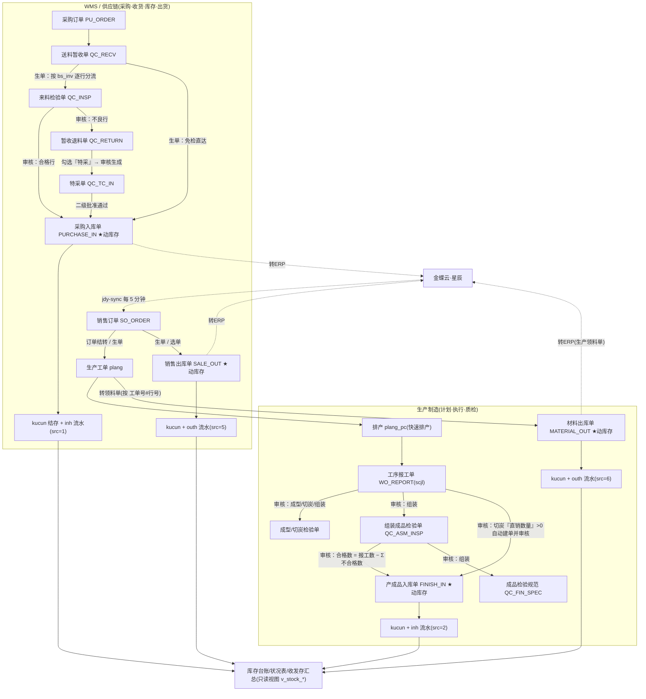

# MES 与 WMS 流程梳理(模块边界 · 主干链路 · 单据衔接 · 库存变动点 · 状态流转)

| 属性 | 内容 |
|---|---|
| 生成日期 | 2026-10-14 |
| 任务性质 | **只读梳理**：未改任何代码/数据、未提交、未启停服务 |
| 依据·导航与流程真源 | `frontend/src/business/menus.js`（左侧导航唯一真源） |
| 依据·后端实现 | `ButtonService.java`(审核/审批钩子、状态推导、归档面板集)、`PanelConfigService.java`(按钮组/选单流向/推式生单目标)、`StockLedgerService.java`、`StockFlowService.java`、`WoReportService.java`、`ManuWritebackService.java`、`OrderConvertService.java`、`WorkOrderPickingService.java`、`QcRecvGenerateHandler.java`、`QcCatalogService.java`、`KingdeePushService.java` |
| 依据·元数据与实库 | `yj_panel`(125 行)、`yj_field`、`yj_doc_status`(30 列)、`form_flow_link`；`HSDZ_MES`(实测 209 表 / 97 视图) |
| 依据·文档 | `CONTEXT.md`(术语表)、`README.md`、`docs/development/数据库表清单.md`、`docs/development/采购链四单字段与显示字段.md`、`docs/design/银嘉MES总流程整理-V1.2.md`、`docs/design/补充设计-V2.0.md` |
| 记号 | **【已验证】** = 本次读代码或查库可直接复现；**【未确认】** = 静态推断、或无法只读验证 |

> ⚠ **前提（影响本文的取证方式）**：正式库 `HSDZ_MES` 当前**没有业务单据数据** ——
> `bd_so_order` 18 行(ERP 同步的销售订单)、`plang`/`plang_pc` 各 25 行、`scjl` 7 行，
> 其余业务单据表(`bd_purchase_in`/`bd_finish_in`/`bd_material_out`/`bd_sale_out`/`sl_recv`/
> `qc_insp`/`qc_return`/`qc_tc_in`/工序检验三单)**全为 0 行**，`form_flow_link` 0 行，
> `kucun`/`inh` 各 31 行且 `src=0` 全是期初结存(`INIT-20261003`)；`bd_so_order` 是 JdySalOrderSync
> 同步进来的销售订单(18 行)，`plang`/`plang_pc` 各 25 行、`scjl` 7 行是仅存的执行层数据。
> 因此：**本文所有链路结论来自代码与元数据，不是从业务数据反推的**。
> "这条链真跑过没有"只能拿测试库旁证：`HSDZ_MES_TEST.form_flow_link` 有 3 条
> `WO_REPORT→QC_MOLD_INSP(ACTIVE)`。测试库同样没有出入库单据数据。

---

## 1. 模块边界

### 1.1 导航一级域(以 `menus.js` 为准)【已验证】

| 一级域 | 二级业务域(菜单) | 现役面板级入口数 | 性质 |
|---|---|---|---|
| 我的桌面 | — | 1(`DASHBOARD`，虚拟入口，不入 `yj_panel`) | 门户 |
| 研发管理 | 项目管理 / 测试记录(数据记录表、实验室使用记录表) / 产品文件 / 共享文件 | 23 | 产品与工艺**源头**，受控文件 |
| 智能供应链 | 销售管理 / 采购管理 / **库存核算** / **库存明细** / **库存统计** / **库存报表** | 21 | **WMS 落点** + 采购销售 |
| 生产制造 | 生产计划 / 生产执行 / 生产记录 / 设备维护 / 样品管理 / 经典单据 | 19 | **MES 主干** |
| 品质管理 | 来料品质 / 制程品质 / 质量单据 | 17 | 跨 MES 与采购链 |
| 基础档案 | 基础数据 / 物料及价格 / 生产 / 财务 | 27 | 共用主数据 |
| **合计** | | **108** | 另有 5 个自建页入口(订单结转/生产工单/快速排产/工单排产/共享文件库)不带面板码或走专用视图 |

> 计数口径：`menus.js` 里带 `panelCode` 的**未注释**叶子项(脚本实测)。`yj_panel` 共 **125** 行
> —— 差额来自已下架但仍留行的面板(见 §6 E)。

> `menus.js` 原有「财务管理」「设备管理」两个一级栏，代码注释记 2026-10-15 按用户口径删除
> —— 它们从建起来就是空的占位分组(`children: []`)，删除不影响任何面板入口。
> (注释日期晚于本次系统时间 2026-10-14，此处照抄代码注释，未另行核实。)

### 1.2 「WMS」在本系统的确切落点【已验证】

**本系统没有名为 WMS 的模块**；不存在 `WMS_*` 面板前缀，也没有独立仓库管理一级域
(README 里的「仓库管理」栏已不存在)。用户/招标口径所称的 WMS，在本系统对应：

| WMS 子域 | 本系统落点 | 面板 |
|---|---|---|
| 库存核算(单据) | 智能供应链 › 库存核算 › 单据 | 送料暂收单 `QC_RECV`、暂收退料单 `QC_RETURN`、采购入库单 `PURCHASE_IN`、产成品入库单 `FINISH_IN`、销售出库单 `SALE_OUT`、材料出库单 `MATERIAL_OUT` |
| 库存明细 | 智能供应链 › 库存明细 | `PURCHASE_IN_DETAIL` / `FINISH_IN_DETAIL` / `SALE_OUT_DETAIL` / `MATERIAL_OUT_DETAIL`（flat 只读视图） |
| 库存统计 | 智能供应链 › 库存统计 | 同上四单的 `*_STATS`（flat 只读视图） |
| 库存报表 | 智能供应链 › 库存报表 | 库存状况表 `STOCK_BALANCE`、库存台账 `STOCK_LEDGER`、收发存汇总表 `STOCK_SUMMARY` |
| 库存主数据 | 基础档案 | 仓库 `WH`、仓位 `WHLOC`、商品 `INV`、存货价格本 `INV_PRICE` |
| 条码/标签 | 商品档案与采购入库单工具栏（非独立面板） | 商品「二维码标签」(75×100mm 标识卡)、采购入库单「打印标识卡」「打印材料码」 |
| 移动端库存 | 自建页 `frontend/src/views/scm/MobileWarehouse.vue` | 入库/出库/库存查看（引用 `STOCK_STATUS` 面板接口） |

### 1.3 「MES」= 生产制造 + 品质管理【已验证】

- **生产制造**：生产计划(订单结转 → 生产工单 → 快速排产 → 工单排产 / 产线排产负荷)、
  生产执行(工序报工单、报工记录、生产异常处理单)、生产记录(日报/投料确认/混合/造粒/无黑/封箱)、
  设备维护(点检/保养)、样品管理、经典单据(工序派工单、委外加工单)。
- **品质管理**：来料品质(来料检验单、特采单、检验目录、检验数据记录、来料检验要求×2)、
  制程品质(成型/切炭/组装成品检验单)、质量单据(成品检验规范 + 7 张 YJ-QR 体系单据)。
- 研发管理是**源头**：产品信息表归档后「分发责任人」决定成型工艺清单/组装工艺清单/规格书/
  出货检验计划表四文件的编辑权（`ButtonService.ensureDevFileEditable`），工艺路线(`ROUTE`)、
  工序(`OP`)、BOM(`WLBOM`/`mate`)是 MES 的输入档案。

### 1.4 单据归属切分（回答"采购入库单算谁的"）【已验证】

| 单据 | 面板编码 | 菜单位置 | `yj_panel.module_group` | 归属判定 |
|---|---|---|---|---|
| 采购订单 | `PU_ORDER` | 智能供应链·采购管理 | 采购管理 | 供应链(采购)，**不属于 MES** |
| 送料暂收单 | `QC_RECV` | 智能供应链·库存核算 | 库存核算 | **WMS 收货口**(仓库建单) |
| 来料检验单 | `QC_INSP` | 品质管理·来料品质 | 智能供应链 | **交界**：单据在品质口，链在采购收货 |
| 暂收退料单 | `QC_RETURN` | 智能供应链·库存核算 | 库存核算 | 交界(仓库退料 + 品质判定) |
| 特采单 | `QC_TC_IN` | 品质管理·来料品质 | 品质管理 | 品质(MES 侧品质)；只生成入库单 |
| **采购入库单** | `PURCHASE_IN` | 智能供应链·库存核算 | 库存核算 | **WMS(唯一真正入库过账的材料入库单)** |
| 产成品入库单 | `FINISH_IN` | 智能供应链·库存核算 | 库存核算 | **交界**：账面归 WMS，生成方是 MES(报工/检验) |
| 材料出库单(领料单) | `MATERIAL_OUT` | 智能供应链·库存核算 | 库存核算 | **交界**：账面归 WMS，动因在 MES(工单行转领料) |
| 销售出库单 | `SALE_OUT` | 智能供应链·库存核算 | 库存核算 | **WMS**；由销售订单生单/选单 |
| 工序报工单 | `WO_REPORT` | 生产制造·生产执行 | 生产制造 | **MES** |
| 成型/切炭/组装成品检验单 | `QC_MOLD_INSP`/`QC_CUT_INSP`/`QC_ASM_INSP` | 品质管理·制程品质 | 生产制造 | **MES**(报工审核自动出的检验单) |
| 成品检验规范 | `QC_FIN_SPEC` | 品质管理·质量单据 | 品质管理 | MES(组装报工审核自动出) |
| 库存状况表/台账/收发存 | `STOCK_BALANCE`/`STOCK_LEDGER`/`STOCK_SUMMARY` | 智能供应链·库存报表 | 库存核算 | **WMS 报表(只读视图)** |

**一句话划界**：凡"单据表的审核会改 `kucun` 现存量"的就是 WMS 记账单(共 4 张)；
凡"驱动生产/质检事实"的是 MES 单据；采购链四单(暂收/检验/退料/特采)**都不改现存量**，
只做链路与判定。

### 1.5 ⚠ `yj_panel.module_group` 不是导航【已验证】

- 例：`QC_INSP` 的 `module_group='智能供应链'`、`category='采购管理'`，菜单却在**品质管理·来料品质**；
  `QC_MOLD_INSP` 的 `module_group='生产制造'`，菜单却在**品质管理·制程品质**；
  库存明细/统计/报表 11 张面板 `module_group='库存核算'`（`category='报表'`），菜单却分在三个二级域。
- `module_group` 是**历史碎值**（15 种上下：采购管理/订单管理/基础设置/基础资料/基础数据/生产管理/
  委外加工/库存核算/库存报表/销售管理/物料及价格/品质管理/研发管理/基础档案/其他…），保留用途是**读权限放行**
  (`PanelPermissionService.readablePanels` 按同模块放行)；对外展示由 `ReportService.NAV_GROUP`
  单向投影到导航一级模块（`NAV_GROUP_ORDER`）。投影后**实际只会出现 6 组**：
  我的桌面 / 研发管理 / 智能供应链 / 生产制造 / 品质管理 / 基础档案 —— 与 `frontend/src/business/menus.js`
  的 6 个一级模块一一对应。
  ⚠ **归并表漏一个值,权限矩阵里就会冒出一个导航没有的野分组**（2026-10-16 用户报障
  「要按照模块来收纳面板，现在多了一个基础设置和系统管理」即此:`基础设置`=25 张基础资料面板漏登记、
  `系统管理`=库存明细那句 `module_group IS NULL ⇒ 系统管理` 的兜底值被写死）。
  闸门:`node tools/verify/perm-groups.cjs`（分组名必须全是导航一级模块 + 不重不漏 + 总数 135）;
  修见 `tools/migrate-stock-detail-module-group-20261016.sql` 与 `ReportService.NAV_GROUP` 的注释。
- 最近两次动它:`tools/fix-stock-report-module-group.sql`（2026-10-10 写、2026-10-14 10:27 执行）把
  4 张库存报表的 `module_group` 从乱码 `????`(3F003F003F003F00) 写回「库存核算」；
  2026-10-16 同族第 5 张 STOCK_DETAIL（库存明细）从「系统管理」写回「库存核算」。

---

## 2. 主干流程

### 2.1 一张图(两链一汇合)【已验证：链路存在；未确认：是否每步都已跑过真实单据】



### 2.2 逐段说明

| # | 段 | 由哪张单驱动 | 系统落点 | 状态 |
|---|---|---|---|---|
| 1 | 销售订单进 MES | 无(MES 不建销售订单) | 独立 Node 工具 **jdy-sync** 定时任务 `JdySalOrderSync`(每 5 分钟)直写 `bd_so_order`/`bl_so_order`，幂等锚点 `外部数据ID` | 【已验证】代码/部署文档；正式库现有 18 行 |
| 2 | 订单 → 生产工单 | **订单结转**(自建页 `/prod/plan/orderConvert`) | `OrderConvertService.toManu` **直接写 `plang`**(键=公司代码+工单号 `pl_no`+工单行号 `pl_xc`)，占用链 `form_flow_link(source=SO_ORDER→target=PLANG)` | 【已验证】代码；`bd_manu_order` 0 行、`plang` 25 行 |
| 3 | 工单排产 | 快速排产(自建页 `/prod/plan/scheduleBoard`) | 写 `plang_pc`(排产行：产线/批次/开工完工)，与 `plang` 1:N | 【已验证】`ScheduleBoardService` INSERT `plang_pc` |
| 4 | 打印工单 / 扫码报工入口 | 生产工单列表页 | 工单二维码 = **公司代码@工单号@(1000+工单行号)**(2026-10-09 规则) | 【已验证】`WorkOrderList.vue:337`、`PanelxList.woQrText` |
| 5 | 生产执行(五道工序) | 工序报工单 `WO_REPORT` | 数据落**单表 `scjl`**(按 报工单号；`gd_id`→`plang_pc.id` 锚定工单行)，审核写 `wgzt='Y'`+`wgsj` | 【已验证】`WoReportService` |
| 6 | 工序质检 | 报工单审核 | 自动生成 `QC_MOLD_INSP`(成型)/`QC_CUT_INSP`(切炭)/`QC_ASM_INSP`(组装成品)草稿；混料、装箱**不出**检验单；组装另生成 `QC_FIN_SPEC` | 【已验证】`ButtonService.woInspGenerate`；测试库有 3 条 ACTIVE 占用链 |
| 7 | 成品入库 | 切炭报工「直销数量」>0 → 自动建 `FINISH_IN` **并审核入账**；组装成品检验审核 → 建 `FINISH_IN` **草稿**(留给仓库审) | 两条路径都写 `加工单号`+`工单行号`+`批次号` | 【已验证】`dualOutFinishIn` / `asmInspToStock` |
| 8 | 领料出库 | 生产工单列表「转领料单」(勾行) | `WorkOrderPickingService` 按 **工单号#工单行号** 建 `MATERIAL_OUT` **只转单头**，材料行由仓库按实发补 | 【已验证】代码；无 BOM 可用(自建 BOM 2026-10-04 下架) |
| 9 | 材料入库(采购链) | 采购订单 → 送料暂收单 → (检验 / 免检) → 采购入库单 | 见 §3；真正入库过账在 `PURCHASE_IN` 审核 | 【已验证】 |
| 10 | 出货 | 销售订单 → 销售出库单(生单/选单) | `SALE_OUT` 审核出库过账 | 【已验证】 |
| 11 | 回传 ERP | 采购入库单 / 销售出库单 / 材料出库单 的「转ERP / 批量转ERP」 | `KingdeePushService`：`PURCHASE_IN→/jdy/v2/scm/pur_inbound`、`SALE_OUT→sal_out_bound`、`MATERIAL_OUT→inv_pick`(金蝶「生产领料单」)；**产成品入库单无转ERP按钮** | 【已验证】`KingdeePushService` + `PANDA_BUTTONS` |
| 12 | 工单回写 | 入库/领料单审核、弃审 | `ManuWritebackService` **重算式回填** `plang.rk_sl/rk_no/ll_no2/cp_date2`，并回填 `scjl.post_no` | 【已验证】 |

---

## 3. 单据衔接（谁生成谁）

### 3.1 `选单`(人工从上游已审核单挑行带入)【已验证：`PanelConfigService.SELECT_FLOWS`】

| 目标单据 | 选单来源 | 备注 |
|---|---|---|
| 送料暂收单 `QC_RECV` | 采购订单 `PU_ORDER` | 采购订单**唯一出口**(2026-09-22 口径：所有采购到货必须先过暂收) |
| 来料检验单 `QC_INSP` | 送料暂收单 `QC_RECV` | 原「暂收入库单」已下线 |
| 暂收退料单 `QC_RETURN` | 来料检验单 `QC_INSP` | |
| 采购入库单 `PURCHASE_IN` | 送料暂收单 `QC_RECV` | 原「采购订单→采购入库单」免检直达已取消 |
| 产成品入库单 `FINISH_IN` | 生产工单 `MANU_ORDER` | 面板编码仍在册，实际工单数据在 `plang`（见 §6 不一致 B） |
| 材料出库单 `MATERIAL_OUT` | 生产工单 `MANU_ORDER` | 同上 |
| 工序派工单 `DISPATCH` | 生产工单 `MANU_ORDER` | |
| 销售出库单 `SALE_OUT` | 销售订单 `SO_ORDER` | 带入销售订单号 + 销售订单行号 |
| 生产工单 `MANU_ORDER` | 销售订单 `SO_ORDER` | 老的选单链，已被订单结转(→`plang`)取代为主路径 |
| 委外加工单 `OUTSOURCE_ORDER` | 销售订单 `SO_ORDER` | |
| 采购订单 `PU_ORDER` | **无上游** | 请购单 2026-10-08 下架后此链消失 |

### 3.2 `生单`(按钮推式生成)【已验证：`PUSH_TARGETS`】

| 来源 | 动作 | 目标 | 行级拆分的实现 |
|---|---|---|---|
| 采购订单 `PU_ORDER` | 生成送料暂收单 | `QC_RECV` | 通用推式生单(支持分批：数量/超送比例) |
| 销售订单 `SO_ORDER` | 生成生产工单 | `MANU_ORDER`(登记值;实走订单结转→`plang`) | 通用 |
| 销售订单 `SO_ORDER` | 生成销售出库单 | `SALE_OUT` | 通用 |
| 生产工单 `MANU_ORDER` | 生成产成品入库单 | `FINISH_IN` | 通用 |
| **送料暂收单 `QC_RECV`** | **生成检验或入库单** | 按行分流到 `QC_INSP` / `PURCHASE_IN` | **`QcRecvGenerateHandler`**：按 `bs_inv` 的检验标志逐行判，两组各出一张草稿 |
| 来料检验单 `QC_INSP` | 生成采购入库单 / 生成暂收退回单 | 按钮组里保留，但**实际生单在审核钩子**里 | 见 §3.3 |
| 生产工单列表页 | 转领料单 | `MATERIAL_OUT`(仅单头) | `WorkOrderPickingService`，标识=工单号#行号 |

**已下架的生单链（不可用，别再引用）**：`WO_ORDER|生成领料单`→材料出库单(随 BOM 2026-10-04 下架)、
`生产工单|生成采购申请`→请购单(同上)、`请购单|生成采购订单`、`采购订单|生成采购入库单`(免检直达，2026-09-22 取消)、
其他入库/其他出库/委外入库/委外发料四条链(2026-10-08 整批下架)。

### 3.3 审核/审批触发的自动生单（钩子，非按钮）【已验证：`ButtonService`】

| 触发点 | 自动产生的单据 | 落点/幂等 |
|---|---|---|
| 送料暂收单**保存/审核**后 | 同步修改已生成的来料检验单(`syncInspFromSlRecv`) | 只同步可编辑的检验单 |
| 来料检验单**审核 / 提交审批→审批通过** | 合格数量>0 的行 → `PURCHASE_IN` 草稿(`实收数量=合格数量`)；不良数量>0 的行 → `QC_RETURN` 草稿 | 回填入库单号；弃审时联动作废草稿+释放占用 |
| 暂收退料单**审核 / 审批通过** | 勾了「特采」明细行 → `QC_TC_IN`(逐行) | 2026-10-04 起特采**只能**从退料单发起 |
| 特采单**二级批准通过** | `PURCHASE_IN`(全部数量，`特采=是`) | 2026-10-04 从"一级通过"挪到二级 |
| 工序报工单**审核** | 成型/切炭/组装 → 三张工序检验单草稿；组装另生成 `QC_FIN_SPEC` 草稿 | `woInspGenerate`，同报工单幂等 |
| 切炭报工单**审核** | `直销数量>0` → `FINISH_IN` **并自动审核过账**(成品仓) | `dualOutFinishIn`；弃审时生成**红字(负数量)**入库单冲回 |
| 组装成品检验单**审核** | 合格数=报工数量−Σ不合格数量 >0 → `FINISH_IN` 草稿 | `asmInspToStock`；**不合格侧不再派生任何单据**(不良品处理单已下架) |
| 采购入库单/销售出库单/材料出库单/产成品入库单**审核↔弃审** | 库存过账/冲回 + 工单回写 | `StockLedgerService` + `StockFlowService` + `ManuWritebackService` |
| 生成来料检验单时 | 按明细物料各建一张「检验数据记录」草稿 + 检验目录行 | `QcCatalogService`(幂等：检验单号+物料编码唯一) |

### 3.4 反向联动（弃审/作废）

- 报工单弃审：其生成的检验单**草稿**作废 + 释放 `form_flow_link`；检验单已审核则拒绝(先弃审检验单)。
- 检验单弃审：自动生成的入库/退料**草稿**作废 + 释放占用 + 清回填单号。
- 切炭报工弃审：生成**红字**成品入库单并过账冲回；若会使现存量变负则**拒绝**弃审。
- 下游草稿删除/作废：`VoucherFlowService.release` 把占用置 `RELEASED`，上游来源行重新可选。

### 3.5 目前**没有**生成关系的（手工录入）【已验证/未确认】

- 采购订单 `PU_ORDER`：正式库 0 行。⚠ **2026-10-14 更正**：本文初版写「未找到 ERP 导入路径、推测手工录入」是**错的** ——
  `deploy/sync-core.mjs:358-361` **明确登记了 `PU_ORDER` → `/jdy/v2/scm/pur_order` → `bd_pu_order`**，
  **导入路径存在**；正式库 0 行的原因是**本机计划任务是否安装/运行过未核**，不是"没有同步配置"。
  （另：`KingdeePushService` 支持推送 `PU_ORDER`，但该面板按钮组里**没有**「转ERP」按钮——这部分结论仍成立。）
- 生产记录一族(日报表/投料确认/混合/造粒/无黑/封箱)、设备点检/保养、样品申请单、
  生产异常处理单、质量单据 7 张、检验数据记录、来料检验要求：**均无生单链，手工录入**。
- 产成品入库单：除上述自动两条路径外，也支持手工「新增」+「选单(生产工单)」。

---

## 4. 库存变动点（务必查实的一节）

### 4.1 真正动库存的只有 4 张单据【已验证：`StockLedgerService.postsStock`】

```java
case "PURCHASE_IN", "FINISH_IN", "MATERIAL_OUT", "SALE_OUT" -> true;   // 其余一律 false
```

| 单据 | 方向 | 改 `kucun` | 写流水 | 段号 `src` | 守卫/口径 |
|---|---|---|---|---|---|
| 采购入库单 `PURCHASE_IN` | 入库(+) | `rkl += qty`、`yl += qty` | `inh` | 1 | 仓库档案必须存在(名称→`bs_wh` 编码)；无批号可入库 |
| 产成品入库单 `FINISH_IN` | 入库(+) | 同上 | `inh` | 2 | 同上 |
| 材料出库单 `MATERIAL_OUT` | 出库(−) | `ckl += qty`、`yl -= qty` | `outh` | 6 | **行必须带批号**，否则审核报错；现存量不足拒绝 |
| 销售出库单 `SALE_OUT` | 出库(−) | 同上 | `outh` | 5 | 同上 |

- **记账粒度** = `(物料编码 wzdm, 仓库编码 ckdm, 批号 lot_no)` 一行；仓库以**名称**入单，
  记账时经 `bs_wh` 解析编码(**编码优先、名称兜底**)。
- **弃审 = 对称冲回**：`forward=false` 走同一段代码反向加减；冲回若使 `yl<0` 抛错并整笔回滚
  (库存已被下游消耗 → 必须先冲销下游单据)。
- **流水是唯一真源，`kucun` 退为结存缓存**(2026-09-30 三表化)：`kucun` 与 `inh`/`outh` 必须同键同量，
  `InvCostService` 有「结存 == Σ流水」双向对账。
- **期初库存**：`inh` 里 `src=0` 的一批(`单据编号=INIT-20261003`，经迁移脚本写入)，对应 `kucun` 的 31 行结存。
- **成本**：`inv_cost_ledger`(移动加权)由 `InvCostService` 在审核/弃审钩子与「重算成本」按钮重算；
  三张库存报表工具栏的「重算成本」= `INV_COST_PANELS`。

### 4.2 会**改库存**但本身不是出入库单的动作【已验证】

| 动作 | 对库存的影响 |
|---|---|
| 切炭报工单审核 | 自动建 `FINISH_IN` 并**立即审核** ⇒ 直接入库过账 |
| 切炭报工单弃审 | 自动建**红字** `FINISH_IN`(负数量)并过账 ⇒ 冲回 |
| 库存状况面板「新增库存」 | 直接 `INSERT kucun` 一行(不经流水；`PanelxList` 的 `STOCK_STATUS` 专用按钮) |

### 4.3 **不动**库存的单据/面板【已验证】

- 采购链四单：送料暂收单、来料检验单、暂收退料单、特采单 —— 只做链路与判定，**零过账**。
  (它们生成的下游 `PURCHASE_IN` 在**下游审核**时才动账。)
- MES 侧：工序报工单、三张工序检验单、成品检验规范、生产异常处理单、生产记录一族、设备维护、样品申请。
- 领料"转单"产生的 `MATERIAL_OUT` **草稿**：不审核就不动账。
- 库存明细表 / 库存统计表 / 库存状况表 / 库存台账 / 收发存汇总表：**flat 模式的只读视图**
  (`v_purchase_in_detail`…、`v_stock_balance`、`v_stock_ledger`、`v_stock_summary`、
  `v_stock_movement` —— 唯一取数口是 `inh`/`outh` 流水，只取 `未作废` 行)。

---

## 5. 状态流转

### 5.1 通用口径（doc 模式单据）【已验证：`ButtonService.docStatusOf` / `QueryService.docStatus`】

```
草稿 ──保存──▶ 草稿(可反复保存)
草稿 ──提交审批──▶ 审批中 ──审批通过──▶ 已审核 ──弃审──▶ 草稿
草稿/已审核 ──作废──▶ 已作废(终态，不可审核)
已审核 ──中止执行/整单中止──▶ 已中止(可取消中止)
```
- 单据状态**不落业务表**，全部由 `yj_doc_status`(panel_code+doc_no) 推导；
  **两处推导必须同改**：`ButtonService.docStatusOf`(按钮/保存门禁) 与 `QueryService.docStatus`(列表行状态)。
- 优先级(高→低)：**已作废 > 已中止(含金蝶手动关闭 H) > 删除申请中 > 修改申请中/已终止 >
  待二级审批 > 审批中 > 修改中 > 已生效 > 已归档 > 已完成(金蝶自动关单 S) > 已审核 > 草稿**。
- 相关列(`yj_doc_status` 30 列)：`shr/shsj`(审核人/时间)、`pending/pending_by/pending_at`(审批中)、
  `archived`、`canceled`、`stopped`、`deleting`(删除申请中)、`modify_state`(R 申请中/Y 修改中)、
  `approve_node`+`l2_approver`(两级)、`effective`(变更生效)、`erp_close_state`(金蝶关单镜像)、`saved`。

### 5.2 特例一：**保存即归档**（`ButtonService.DOC_ARCHIVE_PANELS`）【已验证】

- **现役 21 张**：立项申请、项目实施计划、数据记录表 8、实验室使用记录表 4、
  产品文件族 7(产品信息表/成型工艺清单/成型配方/组装BOM表/组装工艺清单/规格书/出货检验计划表)。
  > ⚠ 术语表 `CONTEXT.md` 写的是「22 面 = … + 样品编号表 1」，**该面板 2026-09-30 已下架并从集合移除**，
  > 现在代码里是 21 面(见 §6 不一致 F)。
- 行为：**管理员点「保存」= 直接归档**(不经审批，同时写审核人 `shr`)；
  **普通用户点「保存」= 自动进审批中**，管理员审批通过后归档。
- 归档后闭环：申请修改 → 管理员通过 → 修改中(可编辑，保存不再自动归档) → 提交审批 → 已归档；
  撤回申请给卡死单据出口。
- 前端经面板配置 `metadata.docArchive` 判断按钮显隐，**不维护清单**；新增此类面板只需在
  `DOC_ARCHIVE_PANELS` 登记一行。
- 刻意**不入**该集合的 3 张研发面板：`RD_PROGRESS`(实时汇总、永远草稿)、
  `RD_PROD_DOCLIST`(只读派生矩阵)、`RD_CHANGE`(自己的状态机，终态「已生效」)。

### 5.3 特例二：**两级审批**（`ButtonService.TWO_LEVEL_PANELS`）【已验证】

共 9 张 = `RD_PROD_INFO` + 8 张质量单据(`ADMIN_L2_PANELS` = `QC_DOC_PREPARER` 键集)：
`QC_TC_IN`/`QC_LYB`/`QC_SCY`/`QC_BHG`/`QC_BHC`/`QC_BHZ`/`QC_JJF`/`QC_SCP`。两型共用状态机，差别在第二级：

| 型 | 面板 | 第二级怎么定 | 终态 |
|---|---|---|---|
| 一级选人型 | `RD_PROD_INFO` | 一级「审批通过」时**必须选取二级审核人**，单据转「待二级审批」(`approve_node=2`+`l2_approver`) | 二级通过 → 已归档 |
| 固定管理员型 | 8 张质量单据 | 第二级**固定为超级管理员**，不选人；一级不选人 | 二级「批准通过」→ 已归档 |

- 两个共性：任一级驳回**一律回草稿**并通知制单人(不退回上一级)；**两级必须各点一次**
  (管理员也要点两次)；「审核」直审对这些面板**一律拒绝**(`audit()` 内拦截)；
  审批中/待二级审批期间不可保存。
- 质量单据纸面「编制/审核/批准」三格自动落值：编制=提交审批的人、审核=一级通过的人、批准=超级管理员；
  这三格在 `yj_field` 里 `editable=0`，且 `save()` **剥离**这些键(真源只有审批流动作)。
  例外：`QC_BHC`/`QC_BHZ`/`QC_SCP` 的「责任人」是**预填可改**的业务格(`PREPARER_EDITABLE_PANELS`)。
- 前端清单 `L2_DOC_PANELS` 必须与后端 `ADMIN_L2_PANELS` 同步，否则按钮显隐与后端门禁不一致。

### 5.4 其他状态相关口径【已验证】

- 单据状态**存储值**是中文(`已审核/草稿/已作废`…)，属数据键，**不随语言变**(ADR-0001)。
- 金蝶同步会**镜像**审核状态到 `yj_doc_status`(`shr/shsj/stopped`、`erp_close_state`)，
  **星辰是销售订单状态的唯一事实源** —— MES 手动审核 5 分钟内会被覆盖。
- 选单只列**已审核**来源；行级占用链 `form_flow_link` 决定"还能选多少"。

---

## 6. ⚠ 文档与实现不一致（逐条）

> 口径：以 `menus.js` / `yj_panel` / 实库结构 / 现役代码为准；旧文档为待修正项。
> 每条给证据位置，便于复核。

### A. `docs/design/银嘉MES总流程整理-V1.2.md` 的实现对照表(§9)已大面积过期

| V1.2 的说法 | 现状 | 证据 |
|---|---|---|
| 「生成工单(ERP审核后自动)」= `WO_ORDER` 选单 `SO_ORDER` | 现役是**订单结转页** `OrderConvertService`，按订单行结转、**直接写 `plang`**；`WO_ORDER` 菜单已下线(面板名仍叫「生产工单(旧版)」) | `OrderConvertService` 类注释；`menus.js:225` 注释；`WO_ORDER` 0 行 |
| 「工单排产」= `WO_SCHEDULE`+`WO_KIT` | **两者菜单均下线**，`v_wo_kit` 随自建 BOM 于 2026-10-04 删除；现役 = 快速排产(`/prod/plan/scheduleBoard`)、工单排产(`/prod/plan/workOrderBoard`)、产线排产负荷 `LINE_LOAD` | `menus.js:222-243` 注释 |
| §8.1「生产排产 MANU_SCHEDULE 面板 + `v_manu_schedule`(54 列)落地」 | `MANU_SCHEDULE` 菜单 2026-09-23 已纠偏下线(面板/权限行保留)，看板职责移到**自建页**工单排产 | `menus.js:227-230` |
| 「品质追溯 = 批号追溯视图，八事件时间线 ✅」 | 视图 **`v_lot_trace` 已删除**(2026-10-09 随「品质追溯」组下架；本次查 `sys.views` 无此视图) | `menus.js:328-333`；实库 `sys.views` |
| 「隔离仓/不良品仓 = 不良品处理单移仓」 | 面板 **`QC_DISPOSAL` 已下架并删表**；组装成品检验单审核时**不合格侧不再派生任何单据** | `ButtonService.asmInspToStock` 注释(2026-10-15 合并时收掉残留分支) |
| 「混料/成型/组装质检数据 = 工序质检单 `QC_OP` ✅」 | `QC_OP`/`QC_RECORD` 2026-10-09 下架删除；现役是成型/切炭/组装三张工序检验单 | `menus.js:317-325` |
| 「暂收→来料检验→合格入库/不合格退回 ✅ 全链E2E」 | 链**仍然有效**，但入口与按钮方式变了：面板编码 `SL_RECV→QC_RECV`(2026-09-20)、生单由两个按钮**收成一个按 `bs_inv` 逐行分流**(2026-10-05)、特采改由**暂收退料单**勾选发起 | `QcRecvGenerateHandler`；`PanelConfigService:889-907` |
| 「打印工单二维码 = 打印工单二维码按钮 ✅」 | 该按钮属于已下线菜单的 `WO_ORDER` 面板；现役工单列表页只打印**生产任务单**(版式内含公司代码/工单行号，二维码规则=公司代码@工单号@1000+行号)。**现役页是否还单独打二维码标签：【未确认】** | `PanelConfigService:919`；`WorkOrderList.vue:337` |
| 「PDA/手机端扫码报工 ⚠ 响应式Web+扫码枪」 | 未复核。顶栏有「移动端扫码报工（建设中）」；另有通用「扫描填单」(`ScanFillDialog`)走 OCR | `TopBar.vue:128`；`PanelxForm.vue:1162` |
| 「线边库存 = 线边仓档案 ⚠」 | **未找到线边仓/线边库存实现**；领料直接扣材料仓。**【未确认】** | 代码检索无命中 |
| 「成本核算 ❌ 待业务规则」 | 已有 `inv_cost_ledger` 移动加权成本 + 三张报表「重算成本」 | `InvCostService`；`INV_COST_PANELS` |

### B. 面板 / 菜单 / 数据表三者错位（"生产工单"这一处最典型）

- 菜单「生产工单」指向**自建页** `/prod/plan/workOrderList`，数据源 = **`plang`**(参考库工单表)；
  而 `yj_panel` 里 `MANU_ORDER`(生产工单，头 `bd_manu_order`) **仍在册**，`bd_manu_order` **0 行**。
  ⇒ 新单不再落 `bd_manu_order`；`MANU_ORDER|生成产成品入库单`、`MANU_ORDER ← SO_ORDER` 等
  登记仍以 `MANU_ORDER` 为键，实际主路径走 `plang` + 订单结转。【已验证】
- 同类：菜单「生产工单明细表/统计表」= `MANU_ORDER_DETAIL/STATS`(视图 `v_manu_order_*`)，
  与 `plang` 是否同源**【未确认】**。

### C. 元数据命名与导航/术语表不一致【已验证】

| 位置 | 值 |
|---|---|
| `yj_panel.panel_name`(QC_INSP) | **`检验单`** |
| 菜单标题 / 文档口径 | **`来料检验单`** |
| 迁移脚本 | `tools/migrate-insp-rename.sql` 明确要求改名为「来料检验单」，但实库仍是「检验单」⇒ 该脚本效果未体现在正式库 |

| 位置 | 值 |
|---|---|
| `yj_panel.panel_name`(QC_RETURN)、`menus.js`、`数据库表清单.md` | **`暂收退料单`** |
| `采购链四单字段与显示字段.md`、多数迁移脚本注释 | **`暂收退回单`** |
| 送料暂收单的别名 | 现役 `送料暂收单`；`AGENTS.md` 写「送料暂收单 QC_RECV(**来料暂收单**)」；另有已下线的「暂收入库单」 |

⇒ 同一张单存在两套叫法，建议以**实库 `yj_panel.panel_name` + `menus.js` 标题**为现役口径。

### D. ⚠ 代码读 `bs_inv.来料检验`，正式库没有这一列（**最要紧的一条**）

- 代码：`QcRecvGenerateHandler.inspectionFlagsOf()` 执行
  `SELECT ... ISNULL(来料检验, N'') AS flag FROM bs_inv WHERE ...`（送料暂收单「生单」的**唯一分流判据**）。
- 实库 `HSDZ_MES.bs_inv`：**无 `来料检验` 列**(`COL_LENGTH('dbo.bs_inv',N'来料检验')` = NULL)，
  实际存在的是 **`是否来料检验` 计算列** =
  `CASE WHEN RTRIM(ISNULL(检验方式,''))='1' THEN N'是' ELSE N'否' END`，另有普通列 `检验方式`。
- 两条迁移脚本都在迁移链里且都在 `yj_schema_log` 有记录：
  `migrate-po-inbound-fields.sql`(建计算列 `是否来料检验`) 与
  `migrate-material-inspection-field.sql`(删计算列、改建真实列 `来料检验`)。
  **实库终态是前者** —— 说明后者的效果当前不在库里(被后续重放覆盖或未生效)。
- 推论：**按现状点送料暂收单的「生单」，分流查询会报「列名 '来料检验' 无效」**。
  **【未实跑】**——生单会落库(建下游单据)，本次任务要求只读，故只做静态核对。
- 附加事实：实库 `bs_inv` 只有 **114 行**，且 `检验方式` **全部为 NULL** ⇒ `是否来料检验` 全为「否」。
  也就是说，即便列名对上，**当前全库物料都会走"免检直达"**，检验链不会自动分流。

### E. 面板已下架但仍登记在 `yj_panel`（无菜单入口）【已验证】

`menus.js` 无对应叶子项、但 `yj_panel` 仍有行的 **17 张**：

| 面板 | 名称 | 现役性 |
|---|---|---|
| `STOCK_STATUS` | 库存状况 | **仍在被调用**：`engine.js.fillCurrentStock`(填现存量)、`MobileWarehouse.vue`、`BusinessOverview.vue` 都直接用 `STOCK_STATUS` 查库存；`PanelxList` 还有 `STOCK_STATUS` 专用的「新增库存」UI。**与「库存状况表 `STOCK_BALANCE`」是两张不同的面板**，名字只差一个字，极易混 |
| `MANU_ORDER` | 生产工单 | 在册但新单落 `plang`(见 B) |
| `WO_ORDER` | 生产工单(旧版) | 已下线 |
| `WO_PROGRESS` / `WO_SCHEDULE` / `MANU_SCHEDULE` | 工单工序进度/排单计划/生产排产 | 已下线(可回滚)。⚠ `MANU_SCHEDULE` 的支撑视图 **`v_manu_schedule` 仍在实库里**，而面板已无菜单入口 |
| `RD_MOLD_FORMULA` / `RD_ASM_BOM` | 成型配方/组装BOM表 | 已并入 `RD_MOLD_PROC`/`RD_ASM_PROC` 页签后下线(配置仍在用) |
| `RD_SINTER_TOL` | 烧结尺寸表 | **无菜单**，只能从成型工艺清单的「配方计算器」弹窗链接进入(`RecipeCalcDialog.vue:344`) |
| `CUSGRP` / `MATGRP` / `SUPGRP` | 客户/商品/供应商分类 | 不占导航，从客户/商品/供应商面板工具栏「分类管理」进入 |
| `QC_ITEM` / `QC_PLAN` | 检验项目/检验方案 | 菜单 2026-10-09 摘除，面板与表保留(检验单弹窗仍在读写 `bs_qc_item`/`bs_qc_plan`) |
| `PARTNER` | 往来单位 | 2026-09-17 菜单下线 |
| `ERPLG_ROW` | ERP 导入明细 | 无独立入口(从 `ERPLG` 下钻) |
| `CGD` / `KHDD` | 采购单/客户订单 | **遗留面板**(表 `Porder`/`order_bs`/`order_bt`)，菜单里从未挂载；`PanelxForm`/`PanelxList` 还有它们的特殊分支 |

### F. 术语表 `CONTEXT.md` 的数字与代码不符【已验证】

- 「文书归档面板 …**共 22 面** …+ 样品编号表 1」：代码 `ButtonService.DOC_ARCHIVE_PANELS`
  现为 **21 个**面板码，且**不含** `RD_SAMPLE_NO`(2026-09-30 下架并同批从集合移除)。
- 同节列「产品文件 7(四受控文件 + 产品信息表 + 成型配方 + 组装BOM)」在集合里仍然成立
  (下线面板的行保留)，差异恰好是样品编号表这一张。

### G. `README.md` 模块与面板数量表已过期【已验证】

| README 表 | 现状 |
|---|---|
| 「仓库管理 …… 1(库存状况)」一级模块 | **菜单里没有「仓库管理」**；库存类面板在智能供应链的库存核算/明细/统计/报表四组 |
| 智能供应链 16 / 生产制造 7 / 研发管理 22 / 基础档案 23 | `yj_panel` 实测 **125 张面板**；`menus.js` 现役面板级入口 **108**(研发 23 / 供应链 21 / 生产制造 19 / 品质 17 / 基础档案 27 / 桌面 1)。README 自称"以 `module_group` 为准"，而 `module_group` 是历史碎值(见 §1.5)，不可当模块数用 |
| 生产制造「生产管理(生产加工单/工序派工单/委外加工单 + 明细 2 + 统计 2)」 | 现役二级域是 生产计划/生产执行/生产记录/设备维护/样品管理/经典单据 六个 |

### H. `数据库表清单.md` 的数字与描述漂移【已验证：本次实测】

- 文档封面写「**208 张表 + 97 个视图**」；实库实测 **209 表 / 97 视图**(视图数一致，表数 +1)。
- `v_stock_movement` 描述为「**8 类出入库单据行**的唯一 UNION 处」：该视图 2026-09-30 起
  **改读流水表 `inh`/`outh`**(定义内注释写明"与 `migrate-stock-movement-from-flow-2026-09-30.sql` 逐字相同")，
  段号 `src` 仍是 0~8 的老口径，但**只有 0(期初)/1(采购入库)/2(产成品入库)/5(销售出库)/6(材料出库)有面板在用**，
  3/4(其他入库/委外入库)与 7/8(其他出库/委外发料)已随面板下架**无来源**。
- `kucun` 的「关联面板 = `STOCK_STATUS`(库存状况)」：该面板菜单已下线(见 E)，但**接口仍在被调用**。

### I. 已下架但仍在文档/注释里的链路（易误引）

`请购单 PU_REQ`(面板+表+菜单已整体删除)、`其他入库/其他出库/委外入库/委外发料` 四单一套
(面板+视图+记账分支删除，`StockLedgerService` 的段号注释保留)、`不良品处理单 QC_DISPOSAL`、
`工序质检单 QC_OP`、`检验记录单 QC_RECORD`、`样品编号表 RD_SAMPLE_NO`、
`MES 自建 BOM(bs_bom + v_wo_kit + 面板 BOM/BOM_FWD/BOM_REV)`。
⇒ 引用这些名字的旧文档段落一律过期。

---

## 7. 未确认 / 查不到的部分（不用推测填表）

1. **送料暂收单「生单」是否真的报错**：静态核对显示会命中不存在的列 `来料检验`(见 §6 D)，
   但未实跑(生单会落库)。**需一次受控实测**：在测试账套建一张暂收单 → 点「生单」→ 看返回。
2. **采购订单的来源**：正式库 0 行。⚠ **2026-10-14 更正**：初版写「未找到 ERP 导入路径（同步器只写销售订单）」
   是**错的** —— `deploy/sync-core.mjs:358-361` 明确登记了 `PU_ORDER` → `/jdy/v2/scm/pur_order` → `bd_pu_order`，
   **导入路径存在**。真正未查实的是：**本机计划任务是否安装/运行过**（所以正式库 0 行）。
   `KingdeePushService` 虽支持推送 `PU_ORDER`，但该面板按钮组无「转ERP」按钮——**这部分仍成立**。
3. **`plang` 与 `v_manu_order_*` 明细/统计表是否同源**：菜单的「生产工单明细表/统计表」面板绑的是
   `v_manu_order_detail/stats`，未逐列核对它们读的是 `plang` 还是 `bd_manu_order`。
4. **线边库存/线边仓**：V1.2 与 `CONTEXT.md` 都提到线边库存，代码里未找到实现。
5. **PDA/手机端扫码报工现状**：只有顶栏「建设中」提示与通用「扫描填单」(OCR)，
   未见扫码报工专用界面。
6. **现役工单列表页是否还有独立的"工单二维码"打印入口**：列表页确认含二维码要素
   (公司代码/工单行号进打印数据)，但独立标签打印是否保留未复核。
7. **`bs_inv` 只有 114 行**（`_wms-doc-shots/README.md` 记录 2026-10-05 时为 3874 行）：
   与"正式库清理测试数据"口径一致，但**清理范围是否含主数据**未与负责人确认。
8. **`来料检验要求(QC_INSP_REQ)` 与检验数据记录的实际挂靠口径**：只读到服务注释
   (`QcCatalogService`)，未做实库数据验证(正式库两表 0 行)。

---

## 附：本文用到的关键取证命令（只读，可复跑）

```powershell
# 面板注册表(名称/模式/头行表/模块分组)
sqlcmd -S localhost,1433 -U yinjia -P '***' -d HSDZ_MES -C -f 65001 -W -s"|" -Q "SET NOCOUNT ON; SELECT module_group, category, panel_code, panel_name, mode, head_table, line_table FROM yj_panel ORDER BY module_group, panel_code;"

# 库存三表与流水段号分布
sqlcmd ... -Q "SELECT src, COUNT(*) FROM inh GROUP BY src; SELECT src, COUNT(*) FROM outh GROUP BY src;"

# 单据状态列
sqlcmd ... -Q "SELECT name FROM sys.columns WHERE object_id=OBJECT_ID('yj_doc_status') ORDER BY column_id;"

# 库存是否与流水对账(应无输出/差为 0)
sqlcmd ... -Q "SELECT k.wzdm,k.ckdm,k.lot_no,k.yl FROM kucun k WHERE ISNULL(k.asp_cancel,'N')<>'Y';"
```
