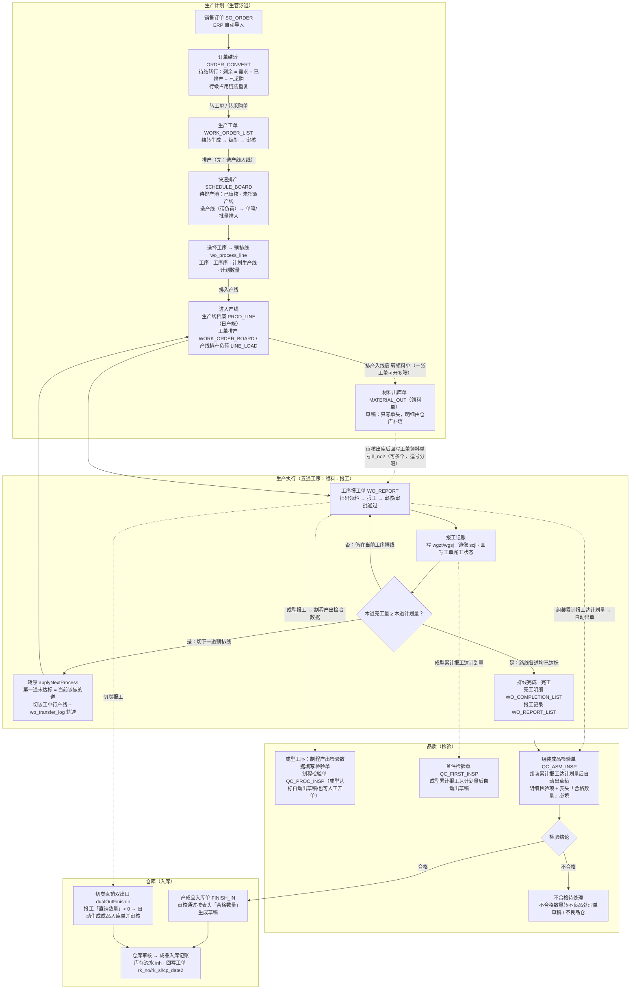

# 生产流程（现役实现）— 销售订单 → 订单结转 → 生产工单 → 排产 → 工序报工 → 完工 → 组装成品检验 → 产成品入库

| 属性 | 内容 |
|---|---|
| 范围 | 用户口述主线：销售订单 → 订单结转 → 生产工单 → **排产（选产线入线）→ 转领料单（一张工单可开多张）** → 工序报工（逐道转序）→ 排线完成·完工 → 组装成品检验单 → 产成品入库；含**成型工序制程产出检验数据填写检验单**。2026-10-18 用户口径：「先要完成排产才进入到领料,同时需要让当前的一个生产工单可以对应多个领料单据」 |
| 依据 | 用户口述（本轮）+ 现役代码逐处核对（提交基线 `f4b42ad5`） |
| 核对文件 | `frontend/src/business/menus.js`（菜单/面板码）、`ButtonService.runWoAuditHooks`（审核钩子链）、`ProcessTaskService.applyNextProcess`（转序）、`WorkOrderListController` + `WorkOrderPickingService`（转领料单）、`ButtonService.asmInspToStock` / `dualOutFinishIn`（入库）、`QcInspAutoService` / `ButtonService.woInspGenerate`（检验出单） |
| 关联 | 银嘉MES总流程整理-V1.2.md、订单结转实现方案-V1.0.md、生产过程差距与检验数据盘点-20261015.md、MES与WMS流程梳理.md |
| 状态 | 现役实现（含 2026-10-16 成型/切炭检验单下架后的口径）；数据现状与差距见 §4 |

## 1. 流程图



> 读图口径：**报工是唯一的推进键** —— 每道工序的排线由该工序报工核销（`本道完工量 ≥ 本道计划量` 即「已落实」），
> 达标后由 `applyNextProcess` 把**该工单行**切到下一道预排线；末道达标即完工，成品入库不在报工里，
> 而在**组装成品检验单审核**时生成。

## 2. 节点 → 现役载体对照

| 流程节点 | 现役载体（面板 / 表 / 接口） | 关键规则 | 取证位置 |
|---|---|---|---|
| 销售订单 | 面板 `SO_ORDER`（ERP 自动导入 + 状态镜像） | 数据来自 ERP，不在 MES 建 | `menus.js` 销售管理；总流程 V1.2 §9 |
| 订单结转 | 页面 `ORDER_CONVERT`（订单结转·发单工作台） | 待结转行：剩余 = 需求 − 已排产 − 已采购；**行级占用链**防重复，转满自动消失；不改销售订单状态 | `menus.js:224-229`、订单结转实现方案-V1.0 |
| 生产工单 | 页面 `WORK_ORDER_LIST`（生产工单，列表式） | 结转入单 → 编制 → 审核；列表按钮：修改/结案/**切单**/**转领料单**/打印工单/导出/排产（**转领料单要求该行已排产入线**，2026-10-18） | `PagePanelRegistry`、`WorkOrderListController` 类注 |
| 排产（领料前置） | 页面 `SCHEDULE_BOARD`（快速排产，排产唯一入口）+ 看板 `WORK_ORDER_BOARD` / `LINE_LOAD` | 待排产池 = 已审核 · 未指派产线 → 选产线（带负荷）→ 单笔/批量排入（写 `scx/pl_sl`）→ 可撤销回池；**排产入线是转领料单的前置条件**（2026-10-18） | `menus.js:235-237`、`ScheduleBoardService.assign` |
| 选择工序 → 产线 | **预排线 `wo_process_line`**（工单号 · 工单行id · 工序 · 工序序 · 计划生产线 · 计划数量 · 状态） | 排产按选中的工序写预排线；转序只认这条台账 | `ProcessTaskService:887-893`、`ScheduleBoardService` |
| 产线 | 生产线档案 `PROD_LINE`（`bs_prod_line` 日产能/小时产能） | 负荷按日产能判超载；同工单多行分线 | `menus.js:246-252` |
| 转领料单 | 按钮 `转领料单`（`picking`）→ **材料出库单 `MATERIAL_OUT`** 草稿 | **先排产后领料**：该工单行必须已排入产线（`scx` 非空）且排产数量 > 0，否则拒绝并提示先去快速排产；按工单号 + **工单行号**逐行生成，**同一工单行可同时开多张**（再次点击=再开一张，备注写明第几张）；**只写单头，明细留空由仓库补填**；审核出库后把该行**全部**领料单号回写工单 `ll_no2`（逗号分隔，列已加宽 400） | `WorkOrderPickingService`、`ManuWritebackService:129-180`、`migrate-material-out-multi-pick-20261018.sql` |
| 工序报工 | 面板 `WO_REPORT`（`scjl`） | 受路线约束、**不跳序校验**；审核与审批通过**共用同一钩子** | `ButtonService.runWoAuditHooks`、`ProcessTaskService` |
| 报工记账 | `woReport.post` + `processTask.onReport` | 写 `wgzt/wgsj`、补工单行号、镜像排产到 `scjl`、重算工单完工状态 | `ButtonService:1864-1892`（HEAD） |
| 工序完成 → 下一工序 | `processTask.applyNextProcess` | 唯一键 = **工单号 + 工单行号**；已达标道 → `已落实`；**第一道未达标 = 当前该做的道**；若该道已预排线则切 `plang`/`plang_pc` 产线并写 `wo_transfer_log`（原因「转序自动派线」） | `ProcessTaskService:874-952` |
| 看板兜底推进 | `advanceSatisfied`（看板/列表加载时） | 手机端报工没有报工单、没人点审核时，**看一眼看板就推进** | `ProcessTaskService:954-978` |
| 排线完成 · 完工 | `WO_COMPLETION_LIST`（完工明细）/ `WO_REPORT_LIST`（报工记录） | 路线各道均已达标 → 完工；组装成品检验已审核 **且** 入库 ≥ 排产 → 工单结案 | `ButtonService.syncCloseAfterAsmInsp` |
| 成型制程检验 | **制程检验单 `QC_PROC_INSP`** | **成型累计已报工量 ≥ 该道计划量**时自动出草稿（2026-10-18 起；手机端直写也触发），仍保留人工「选生产工单」入口——该弹窗**只列已排产入线（成型已排）**的工单行（`WoInspGate.pickable`）；明细留空由品质带入 | `QcInspAutoService`、`QcProcInspController` |
| 首件检验 | **首件检验单 `QC_FIRST_INSP`** | **成型累计已报工量 ≥ 该道计划量**时自动出草稿（数据驱动，不要求报工单/审核）；明细按《成型工艺清单》`RD_MOLD_PROC` 预铺。生产日期/批号在工单行首批完工时回填。**人工「选生产工单」入口（2026-10-20）只列「未完工 + 未结案 + 本行还没有存活首件单」的行**，不受成型报工门禁约束（脱模后即可开首件） | `QcInspAutoService`、`ButtonService.woInspGenerate`、`FirstInspBackfill`、`QcFirstInspController` |
| 组装成品检验 | **组装成品检验单 `QC_ASM_INSP`** | **组装累计已报工量 ≥ 该道计划量**（且成型已达标）时自动出草稿；幂等键 = 工单号 + 工单行号；明细按《出货检验计划》预铺外观/尺寸/出货重量，表头「合格数量」必填 | `QcInspAutoService`、`ButtonService.woInspGenerate` |
| 检验结论 → 入库 | `ButtonService.asmInspToStock` | **只在审核/审批通过时**按表头「合格数量」生成**产成品入库单草稿**（保存/草稿阶段不碰库存）；没填/负数/超检验数量 ⇒ **拒绝审核**；= 0 合法（不生成入库单）；弃审把该草稿作废 | `ButtonService:3308`、`AsmInspStockQty` |
| 产成品入库 | 面板 `FINISH_IN`（`bd_finish_in`/`bl_finish_in`） | 草稿 → 仓库审核记账（库存流水 `inh`）；回写工单 `rk_no/rk_sl/cp_date2` | `ManuWritebackService`、出入库单据字段与显示字段.md §产成品入库单 |
| 切炭直销双出口 | `ButtonService.dualOutFinishIn` | 切炭报工「直销数量」> 0 → 自动生成成品入库单**并审核入账**（成品仓）；直销数量不得大于报工数量 | `ButtonService:2875-2890` |

### 2.1 工序 → 产线车间口径：**装箱归组装**（2026-10-21 用户口径）

> 用户原话：「当前生产的工单对当前的生产排产只有对应的工序名称才能进入到对应的生产线，
> 当前组装和装箱工序都是同样进入组装生产线才对。」

**唯一口径 = `ProcessShop`（`backend/.../service/ProcessShop.java`，纯函数）**：

| 工序 | 产线车间（`bs_prod_line.生产车间`） | 可进哪些线 |
|---|---|---|
| 成型 | 成型 | 成型车间下的线（1~7 号机/车间、成型 1~5 线、自动线…） |
| 切炭 | 切炭 | 切炭车间下的线 |
| 组装 | 组装 | 组装车间下的线（组装 1/2、组装线…） |
| **装箱** | **组装** | **同一批组装车间下的线**（组装线 + 装箱 1/2、装箱线）——**不为装箱单另开一个车间** |
| 其它（下料/车削/检验…） | 路线登记的车间 | 不猜；路线也没填 ⇒ 不判（不瞎拦） |

- **判据只有一个**：产线的 `生产车间` 必须等于工序的归口车间（`ProcessShop.matches`）；判不出时放行。
  ⚠ **2026-10-28 起改走 `ProcessTaskService.requiredShop`**：只对「认得的工序 + 该车间确有启用线」拦，
  其它工序（含以后新建的）一律放开、弹窗列全部产线 —— 见 §2.2。
  用在：①派工 `ProcessTaskService.assign`；②预排线弹窗 `routeSteps` 的候选线；
  ③排线保存 `preplanManual`；④下一道工序候选线 `nextProcess`；⑤工序任务生成时落 `wo_progress.生产车间`；
  ⑥**自动转序** `applyNextProcess` —— 计划线的车间配不上这道工序时**不切**，只提示重新排线。
- **起因（两个坑互相加剧）**：工艺路线面板的「生产车间」下拉此前写死成
  `熔铸车间/轧制车间/精整车间/测试车间`（钢铁类遗留值），炭棒的 `成型/切炭/组装` 选不出来 ⇒
  路线车间只能留空（实测 `GY-2026-10-0001` 成型→装箱 两条明细全空）；空值 ⇒ 排线没有车间判据 ⇒
  排线弹窗把全部产线都摆出来，**装箱被排到了成型线**（实测 `GD-2026-10-0202` 行6：装箱 → 2号车间）。
- **数据修复**：`tools/migrate-route-workshop-options-20261021.sql` ——
  ①「生产车间」下拉 = 产线档案真实车间 ∪ 路线历史值（遗留路线照旧可维护）；
  ②补齐路线里空着且工序可判归属的车间（装箱→组装）。两账套均已执行。
- **存量脏数据**：`GD-2026-10-0202` 行6 的预排台账仍是「装箱:2号车间」，自动转序会**拦住并提示**
  「计划线属于成型车间，与工序应进的组装车间不一致，请撤销该行排产后重新排线」——
  人工重排一次即回到正确线（不自动改业务台账）。

### 2.2 工序→车间：**只拦"认得的工序"，其余一律放开**（2026-10-28 用户口径）

> 用户原话：「这个工序不是成型→切炭→组装这个工序的话，即使我为现在的工序进行了排产线的处理，
> 也无法实现对应处理……需要最后的工序设置为装箱，我就无法选择到产线，因为现在没有装箱的这个产线类型
> 存在，导致无法填写这个对应的产线就被卡住，这种情况就需要显示出全部的产线来实现选择。」
> 追认口径：**以后新建的任意工序，都必须能选到产线**。

**判据收口成一句**：`ProcessTaskService.requiredShop(op, routeShop)` —— 返回**车间名**才拦，
返回 `null` 就不设限。只有两种情况会拦：

| 情形 | 结果 |
|---|---|
| 工序在 `ProcessShop` 表里（成型/切炭/组装/装箱，装箱归组装）**且**该车间在 `bs_prod_line` 里**有启用线** | 拦截：线必须属于该车间（2026-10-21 口径不变） |
| 工序**不在**表里（下料/车削/检验，以及以后新建的封箱/喷码/包装…） | **不拦**：预排线弹窗列**全部启用产线**，保存/派工/转序全部放行 |
| 工序在表里但该车间**一条启用线都没有**（还没建线、路线写着历史车间名如「熔铸车间」「装箱车间」） | **不拦**：同上，否则弹窗一条线都列不出来、保存必被拒，新工序直接被卡死 |

- **前端同口径**：`routeSteps` 每道工序多回一个 `限定车间` 布尔；弹窗用
  `business/routeDefaults.lineOptions()` 决定下拉内容 —— `限定车间=true` 才按车间筛，
  否则列全部启用线，并在「生产车间」列打 `全部产线` 标签 + 表下提示一句（避免误以为筛选坏了）。
- **服务端同口径**：`preplanManual`（排线保存）、`assign`（派工）、`applyNextProcess`（自动转序）
  全部改走 `requiredShop`，不再直接调 `ProcessShop.matches` —— 只放开前端而服务端仍硬拒，
  就会出现「选得到、存不进去」，正是本轮报障的形态。
- **不做的事**：不替新工序猜车间（`ProcessShop.resolve` 仍返回空串），不改任何已有台账。
- **取证（2026-10-28，测试账套 `HSDZ_MES_TEST`）**：临时路线「成型 → 封箱（车间空/写成不存在的
  「装箱车间」）」——
  ① `routeSteps` 回落 `封箱 · 限定车间=false`；② `preplan` 把封箱排到 `切炭4(X)`（跨车间）**成功**
  （改前必报「应进的装箱车间不一致」）；③ 回归：`成型 → 切炭4(X)` 仍被拒（「属于切炭，与成型应进的
  成型车间不一致」）。探针与清理见 `tools/archive/_newop-line-pick-20261028/`。

### 2.3 订单结转的工艺路线预填：**同物料 > 同品名同规格族 > 档案绑定**（2026-10-29 用户口径）

> 用户原话：「需要放到的是要同规格通品名的产品实现，不然当前只是根据上次的随便一条转工单的
> 工艺路线就没有实际存在的意义实现了。」

**问题**：2026-10-25 的预填只按**物料编码**取「最近一次转单路线」。同一款产品在系统里常按客户/供应商
拆成多个存货编码（如 `S031-1` / `S031-3`、`B-58-07` / `B-58-10`），各编码历史互不相干 ⇒
等于"随便一条以前的转单路线"，同款产品之间还会互相矛盾。实测待结转 226 行 = 144 个
「品名+型号」家庭，其中 **13 个家庭跨多个编码**、**4 个家庭里不同编码的"上次路线"互相矛盾**。

**口径（三档）**：

| 档 | 取数键 | 来源 | 说明 |
|---|---|---|---|
| ① 同物料 | `plang.dm = 结转行.存货编码` | 最近一次转出的工单路线（`pl_date DESC, id DESC`） | 最贴近这个编码自己 |
| ② 同品名同规格（族兜底） | `plang.mc + ISNULL(plang.gg,'')` = `存货名称 + ISNULL(规格型号,'')` | 家庭里**任一**编码最近一次转单路线 | 只有 ① 没历史（或路线已不在 `bs_route`）才用；空名称不参与，空规格只与同为空的同品名行匹配 |
| ③ 档案绑定 | `bs_inv.工艺路线` | 产品档案 | 原逻辑，仍兜最后一层 |
| — | 三档皆无 ⇒ 留空 | — | 显示「未选择」，转工单被拦（需手选） |

- **实现落点**：后端 `OrderConvertService.PENDING_FROM` 两个派生表（`lastroute` / `specroute`，
  都 `ROW_NUMBER() ... rn=1`，至多 1:1，不膨胀行数，`stats/pendingAgg` 聚合口径不变）；
  前端 `frontend/src/business/routeDefaults.js` 的 `pickRouteDefault/applyRouteDefaults`
  （纯函数，`routeDefaults.test.js` 27 条断言钉住）。
- **候选校验**：带出的路线必须 ∈ `bs_route` 编码集合，否则下探一档（族路线已删不会带出死编码）。
- **审核闸不动**：`QuickScheduleService.requireRouteAudited` 照旧 —— 带出只是预填，未审核的（含族带出）
  照样标红、照样转不了单；后端 `createFromOrderLine` 空路线/未审核双拦。
- **界面**：路线列小标「上次」（同物料）/「同规格上次」（族兜底），tooltip 写明来源工单+日期与口径。
- **零库变更**：不建表、不加列、不改面板字段，无迁移脚本。

### 2.4 生产工单·批量排产：**多行排入同一组产线，排产数量逐行算**（2026-10-30 用户口径）

> 用户原话：「排产数量按各行根据各行的算，这样各个工单排产的产线都是相同的，
> 本身当前作为排产的就是实现将多个工单排入相同产线的操作罢了。」

- **入口**：生产工单列表勾 N 行 →「排产」。勾 1 行 = 原内嵌快速排产（`keyword=工单号#行号`）+
  单行排线弹窗 `ProcessRoutePlanDialog`（**逐字不动**）；勾 N 行 = **仍打开内嵌快速排产页**
  （`ScheduleBoard.vue`，不新建页面），①待排产池由前端按勾选的 `行id列表` 收敛并默认全选，
  ②已排产按 `工单号列表` 收敛；点「批量排产」出 `ScheduleBatchDialog.vue`。
- **批量语义**：整批共用**每道工序一条生产线**（选线仍走 `routeDefaults.lineOptions` 的车间口径：
  成型/切炭/组装/装箱 + 其余工序列全部启用线）；排产班组、计划完工日期整批共用
  （完工日期留空 = 各行按自己的交期）。
- **排产数量**：逐行、各行按各行算 —— 默认 = 该行当前排产数量（>0）否则需求数量，可改小，
  `0 < 数量 ≤ 该行需求数量`（前端 `scheduleBatch.validateQty` + 后端 `preplanManual` 双拦）。
- **工序不同 ⇒ 点名排除**：按「工序链」（工序名称 + 顺序，`>` 连接）分组，默认排行数最多的一组；
  其余组/未绑路线的行在弹窗顶部逐条点名（`工单号#行号 —— 工序不同（成型>装箱）`），不参与本批。
- **换算率不同 ⇒ 允许同批、各自换算**：换算率是**工艺路线明细**字段（`bs_route.换算率`），
  同一路线编码各行必然相同 ⇒「同链不同率」= 两条同链不同率的路线。计划量仍 = 本行排产数量 ×
  本行该道换算率（`ProcessTaskService.preplanManual` 落库时按行重算，**不累乘**）；本批每道合计
  = Σ(各行数量 × 各行率)，不是「合计数量 × 某个率」。弹窗对率不同的行标黄、工序列显示「各行不同」。
- **提交**：逐行调用既有 `/px/scheduleBoard/preplan`（同一套守卫/预排台账/留痕），部分失败点名、
  成功的保留（不整批回滚）。
- **实现落点**：`frontend/src/business/scheduleBatch.js`（纯函数，`scheduleBatch.test.js` 12 条断言）
  + `ScheduleBatchDialog.vue`（新弹窗）+ `ScheduleBoard.vue`（新增可选参数 `行id列表/工单号列表`，
  不传时原行为逐字不变）+ `WorkOrderList.vue`（勾 N 行入口，先点名排除已排产/已结案/已完工）。
- **零库变更 / 零后端变更**：不建表、不加列、无迁移；不改 `/preplan`、`assign` 等接口。
- **验证**：两账套 UI 只读验证(勾选→内嵌页收敛→批量弹窗→取消,未写库)PASS；
  测试库(成型换算率=3)计划量链 600·200·200 / 1500·500·500 证明按行换算不串。
  探针、截图与复跑说明见 `tools/archive/_batch-sched-20261030/README.md`。
- **已知边界**：`preplanManual` 按「工序名称」匹配 steps —— 路线里同一工序重复出现时
  （`GY-001/002/003` 每条重复两次）会给两道用同一条线，属既有隐患，本次未改后端；
  正式库工单现均为 `GY-CB-STD`（无重名）。

## 3. 报工审核钩子链（`runWoAuditHooks`，同一事务内按序执行）

```
WO_REPORT 审核 / 审批通过
  ├─ woReport.post            记账：写 wgzt/wgsj、补工单行号、镜像排产到 scjl
  ├─ processTask.onReport     工序任务回写 + 工单完工状态重算
  ├─ applyNextProcess         转序：前道完工 → 切下一道预排线（逐行）
  ├─ woInspGenerate           工序检验单：按 QcInspAutoService 判据出草稿（幂等）
  │    └─ 成型达标 → 首件 QC_FIRST_INSP + 制程 QC_PROC_INSP；组装达标 → QC_ASM_INSP
  ├─ asmInspToStock           组装成品检验审核 → 按合格数量生成 FINISH_IN 草稿
  ├─ dualOutFinishIn          切炭直销数量 → 成品入库单（自动审核）
  ├─ manuWriteback.post       入库回写 rk_sl/rk_no、领料回写 ll_no2
  └─ syncCloseAfterAsmInsp    组装成品检验审核 → 重算结案
```

要点：

1. **一处定义、两个入口**：审核与「审批通过」共用本方法（`ButtonService:1712`），各钩子内部自筛面板，非本面板直接 return。
2. **幂等与对称**：自动出单按「报工单号 + 工序」查存活单去重；报工**弃审**时作废对应自动单据并释放占用，可再次生成。
3. **越权/超量守卫**：组装成品检验表头合格数量在**真正消费它的那一刻**兜底校验（拒绝审核），不靠前端置灰。

## 4. 与总流程图 V1.2 / 数据现状的差异（现役口径）

| # | 总图口径 | 现役实现 | 影响 |
|---|---|---|---|
| 1 | 五道工序：混料 → 成型 → 切炭 → 组装 → 装箱 | 现役标准路线 `GY-CB-STD` **只有 成型 → 切炭 → 组装**；混料/装箱报工**不出检验单**。2026-10-20 起另有「成型 → 装箱」的**乙级客户路线** `GY-2026-10-0001`（装箱与组装同进组装车间的线，见 §2.1） | 图上「五道工序」按路线实际道数落 |
| 2 | 装箱后成品入库 | 成品入库改由**组装成品检验单审核 → 合格数量转产成品入库单**承接 | 装箱不驱动入库 |
| 3 | 成型/切炭各自一张工序检验单 | `QC_MOLD_INSP` / `QC_CUT_INSP` 于 **2026-10-16 连面板与物理表一起下架**；职能由 `QC_PROC_INSP`（成型达计划量自动出草稿，也可人工开单）+ `QC_FIRST_INSP`（成型达计划量自动出草稿）承接 | 制程检验入口保留，自动出单走 `QcInspAutoService` |
| 4 | 工单排产含齐套表 | 齐套表 `WO_KIT` 随自建 BOM 于 2026-10-14 整体下架 | 缺料校验不在现役链上 |
| 5 | 所有报工在 PDA/手机端扫码 | 现役为响应式 Web 表单录报工（顶栏「移动端扫码报工」为建设中图标） | 扫码能力待补 |
| 6 | — | 数据现状（2026-10-16 正式库 `HSDZ_MES` 实测）：`scjl` 未作废报工 **3 行**（全部已审核，`直销数量` 全为 NULL）、**材料出库单 0 张**、**MES 自建产成品入库单 0 张** —— `bd_finish_in` 里 231 张已审核的是金蝶导入的「产品入库单」`CPRK-*`，唯一一张 `FI-2026-09-0001` 是生产加工单按钮留的测试草稿（详见 §4.1） | 图为主干，领料/入库段尚无真实数据跑通 |
| 7 | — | 订单结转的「转采购单」出口与工单**分属两条链**，后续在采购链汇合（见 银嘉MES总流程整理-V1.2 §3 #5） | 主线只取「转工单」 |

### 4.1 「切炭直销入库」是什么（图上 `CUTOUT` 那个节点）

- **业务**：切炭（图面旧称「裁切」）是**双出口** —— 切出的合格炭棒一部分**不继续组装**，直接作为半成品**对外直销 / 入成品仓**，其余继续组装（银嘉MES总流程整理-V1.2 §5.1「裁切双出口」）。
- **载体**：报工单上的 **`直销数量`**（`scjl.直销数量`，银嘉独有列，`decimal(18,4)`，默认 0）—— 它表达「该次报工数量里有多少走了直销出口」，其余即继续组装；报工保存时校验 **`直销数量 ≤ 报工数量`**（`WoReportService:222`）。
- **实现**：切炭报工单**审核/审批通过**时，`ButtonService.dualOutFinishIn` 自动建一张 **`FINISH_IN` 成品入库单并直接审核入账**
  （仓库=成品类启用仓、车间=切炭车间、带工单行号+批次号、单价取 `plang.dj`；`plang.lot_no` 为空则现场取号并回写），
  回执写回报工行 `scjl.post_no`；`form_flow_link`(`WO_REPORT`→`FINISH_IN`) 保证重审幂等（`ButtonService:2875-2962`）。
- **反向**：弃审切炭报工单 → `dualOutRedReverse` 自动补一张**红字（负数量）**入库单并审核，台账 `rkl/yl` 对称扣减，原单保留作审计线索（`ButtonService:4038-4085`）。
- **与组装那条入库的区别**：直销是**报工审核即建单并自动过账**；组装成品检验审核建的 `FINISH_IN` 是**草稿**，要仓库再审核（见 §2、§3）。
- **字段登记**：`yj_field`(WO_REPORT) 里 `直销数量` = `place='query,detail'`、`seq=55`（紧随「报工数量」seq 50）、`visible=1/hidden=0/required=0`
  ⇒ 它是**报工单表格里的可填列**；`WO_REPORT` 的表头字段只登记了「单据编号/单据日期」两项。
- **有没有数据**：正式库**零真实数据** —— `scjl` 3 行报工的 `直销数量` 全为 NULL；`bd_finish_in` 里那张 `FI-2026-09-0001` **不是**直销链生成的
  （它的占用链来源面板是 `MANU_ORDER`「生成产成品入库单」按钮，2026-09-24 的测试草稿，状态=草稿、`inh` 无流水）。
  取证脚本与逐条数据：`tools/archive/_dualout-probe/`（只读探针 + README 结论）。

## 5. 面板 / 表速查（本流程直接涉及）

| 面板 / 页面 | 面板码 | 底表 | 环节 |
|---|---|---|---|
| 销售订单 | `SO_ORDER` | `bd_sale_order` / `bl_sale_order` | 起点 |
| 订单结转 | `ORDER_CONVERT` | 销售订单行 + `plang` + 采购 | 结转发单 |
| 生产工单 | `WORK_ORDER_LIST` | `plang` / `plang_pc` | 主对象（工单行） |
| 快速排产 | `SCHEDULE_BOARD` | `plang` + `wo_process_line` + `bs_prod_line` | 排产 |
| 工单排产 / 产线排产负荷 | `WORK_ORDER_BOARD` / `LINE_LOAD` | `plang_pc` / `v_line_load` | 产线视图 |
| 工序报工单 / 报工记录 / 完工明细 | `WO_REPORT` / `WO_REPORT_LIST` / `WO_COMPLETION_LIST` | `scjl` | 执行 |
| 首件检验单 | `QC_FIRST_INSP` | `qc_first_insp_head` / `_detail` | 成型首批 |
| 制程检验单 | `QC_PROC_INSP` | `qc_proc_insp_head` / `_detail` | 成型制程产出 |
| 组装成品检验单 | `QC_ASM_INSP` | `qc_asm_insp_head` / `_detail` | 末道检验（合格数量 → 入库） |
| 材料出库单（领料单） | `MATERIAL_OUT` | `bd_material_out` / `bl_material_out` | 领料 |
| 产成品入库单 | `FINISH_IN` | `bd_finish_in` / `bl_finish_in` | 成品入库 |
