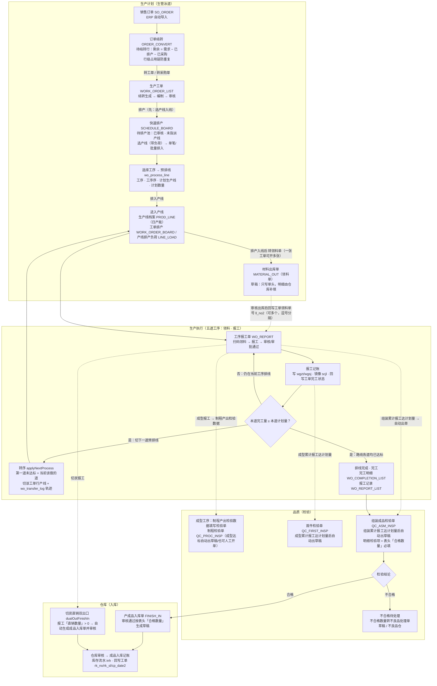

# 生产流程（现役实现）— 销售订单 → 订单结转 → 生产工单 → 排产 → 工序报工 → 完工 → 组装成品检验 → 产成品入库

| 属性 | 内容 |
|---|---|
| 范围 | 用户口述主线：销售订单 → 订单结转 → 生产工单 → **排产（选产线入线）→ 转领料单（一张工单可开多张）** → 工序报工（逐道转序）→ 排线完成·完工 → 组装成品检验单 → 产成品入库；含**成型工序制程产出检验数据填写检验单**。2026-10-18 用户口径：「先要完成排产才进入到领料,同时需要让当前的一个生产工单可以对应多个领料单据」 |
| 依据 | 用户口述（本轮）+ 现役代码逐处核对（提交基线 `f4b42ad5`） |
| 核对文件 | `frontend/src/business/menus.js`（菜单/面板码）、`ButtonService.runWoAuditHooks`（审核钩子链）、`ProcessTaskService.applyNextProcess`（转序）、`WorkOrderListController` + `WorkOrderPickingService`（转领料单）、`ButtonService.asmInspToStock` / `dualOutFinishIn`（入库）、`QcInspAutoService` / `ButtonService.woInspGenerate`（检验出单） |
| 关联 | 银嘉MES总流程整理-V1.2.md、订单结转实现方案-V1.0.md、生产过程差距与检验数据盘点-20261015.md、MES与WMS流程梳理.md |
| 状态 | 现役实现（含 2026-10-16 成型/切炭检验单下架后的口径）；数据现状与差距见 §4 |

## 1. 流程图



> 读图口径：**报工是唯一的推进键** —— 每道工序的排线由该工序报工核销（`本道完工量 ≥ 本道计划量` 即「已落实」），
> 达标后由 `applyNextProcess` 把**该工单行**切到下一道预排线；末道达标即完工，成品入库不在报工里，
> 而在**组装成品检验单审核**时生成。

## 2. 节点 → 现役载体对照

| 流程节点 | 现役载体（面板 / 表 / 接口） | 关键规则 | 取证位置 |
|---|---|---|---|
| 销售订单 | 面板 `SO_ORDER`（ERP 自动导入 + 状态镜像） | 数据来自 ERP，不在 MES 建 | `menus.js` 销售管理；总流程 V1.2 §9 |
| 订单结转 | 页面 `ORDER_CONVERT`（订单结转·发单工作台） | 待结转行：剩余 = 需求 − 已排产 − 已采购；**行级占用链**防重复，转满自动消失；不改销售订单状态 | `menus.js:224-229`、订单结转实现方案-V1.0 |
| 生产工单 | 页面 `WORK_ORDER_LIST`（生产工单，列表式） | 结转入单 → 编制 → 审核；列表按钮：修改/结案/**切单**/**转领料单**/打印工单/导出/排产（**转领料单要求该行已排产入线**，2026-10-18） | `PagePanelRegistry`、`WorkOrderListController` 类注 |
| 排产（领料前置） | 页面 `SCHEDULE_BOARD`（快速排产，排产唯一入口）+ 看板 `WORK_ORDER_BOARD` / `LINE_LOAD` | 待排产池 = 已审核 · 未指派产线 → 选产线（带负荷）→ 单笔/批量排入（写 `scx/pl_sl`）→ 可撤销回池；**排产入线是转领料单的前置条件**（2026-10-18） | `menus.js:235-237`、`ScheduleBoardService.assign` |
| 选择工序 → 产线 | **预排线 `wo_process_line`**（工单号 · 工单行id · 工序 · 工序序 · 计划生产线 · 计划数量 · 状态） | 排产按选中的工序写预排线；转序只认这条台账 | `ProcessTaskService:887-893`、`ScheduleBoardService` |
| 产线 | 生产线档案 `PROD_LINE`（`bs_prod_line` 日产能/小时产能） | 负荷按日产能判超载；同工单多行分线 | `menus.js:246-252` |
| 转领料单 | 按钮 `转领料单`（`picking`）→ **材料出库单 `MATERIAL_OUT`** 草稿 | **先排产后领料**：该工单行必须已排入产线（`scx` 非空）且排产数量 > 0，否则拒绝并提示先去快速排产；按工单号 + **工单行号**逐行生成，**同一工单行可同时开多张**（再次点击=再开一张，备注写明第几张）；**只写单头，明细留空由仓库补填**；审核出库后把该行**全部**领料单号回写工单 `ll_no2`（逗号分隔，列已加宽 400） | `WorkOrderPickingService`、`ManuWritebackService:129-180`、`migrate-material-out-multi-pick-20261018.sql` |
| 工序报工 | 面板 `WO_REPORT`（`scjl`） | 受路线约束、**不跳序校验**；审核与审批通过**共用同一钩子** | `ButtonService.runWoAuditHooks`、`ProcessTaskService` |
| 报工记账 | `woReport.post` + `processTask.onReport` | 写 `wgzt/wgsj`、补工单行号、镜像排产到 `scjl`、重算工单完工状态 | `ButtonService:1864-1892`（HEAD） |
| 工序完成 → 下一工序 | `processTask.applyNextProcess` | 唯一键 = **工单号 + 工单行号**；已达标道 → `已落实`；**第一道未达标 = 当前该做的道**；若该道已预排线则切 `plang`/`plang_pc` 产线并写 `wo_transfer_log`（原因「转序自动派线」） | `ProcessTaskService:874-952` |
| 看板兜底推进 | `advanceSatisfied`（看板/列表加载时） | 手机端报工没有报工单、没人点审核时，**看一眼看板就推进** | `ProcessTaskService:954-978` |
| 排线完成 · 完工 | `WO_COMPLETION_LIST`（完工明细）/ `WO_REPORT_LIST`（报工记录） | 路线各道均已达标 → 完工；组装成品检验已审核 **且** 入库 ≥ 排产 → 工单结案 | `ButtonService.syncCloseAfterAsmInsp` |
| 成型制程检验 | **制程检验单 `QC_PROC_INSP`** | **成型累计已报工量 ≥ 该道计划量**时自动出草稿（2026-10-18 起；手机端直写也触发），仍保留人工「选生产工单」入口——该弹窗**只列已排产入线（成型已排）**的工单行（`WoInspGate.pickable`）；明细留空由品质带入 | `QcInspAutoService`、`QcProcInspController` |
| 首件检验 | **首件检验单 `QC_FIRST_INSP`** | **成型累计已报工量 ≥ 该道计划量**时自动出草稿（数据驱动，不要求报工单/审核）；明细按《成型工艺清单》`RD_MOLD_PROC` 预铺。生产日期/批号在工单行首批完工时回填。**人工「选生产工单」入口（2026-10-20）只列「未完工 + 未结案 + 本行还没有存活首件单」的行**，不受成型报工门禁约束（脱模后即可开首件） | `QcInspAutoService`、`ButtonService.woInspGenerate`、`FirstInspBackfill`、`QcFirstInspController` |
| 组装成品检验 | **组装成品检验单 `QC_ASM_INSP`** | **组装累计已报工量 ≥ 该道计划量**（且成型已达标）时自动出草稿；幂等键 = 工单号 + 工单行号；明细按《出货检验计划》预铺外观/尺寸/出货重量，表头「合格数量」必填 | `QcInspAutoService`、`ButtonService.woInspGenerate` |
| 检验结论 → 入库 | `ButtonService.asmInspToStock` | **只在审核/审批通过时**按表头「合格数量」生成**产成品入库单草稿**（保存/草稿阶段不碰库存）；没填/负数/超检验数量 ⇒ **拒绝审核**；= 0 合法（不生成入库单）；弃审把该草稿作废 | `ButtonService:3308`、`AsmInspStockQty` |
| 产成品入库 | 面板 `FINISH_IN`（`bd_finish_in`/`bl_finish_in`） | 草稿 → 仓库审核记账（库存流水 `inh`）；回写工单 `rk_no/rk_sl/cp_date2` | `ManuWritebackService`、出入库单据字段与显示字段.md §产成品入库单 |
| 切炭直销双出口 | `ButtonService.dualOutFinishIn` | 切炭报工「直销数量」> 0 → 自动生成成品入库单**并审核入账**（成品仓）；直销数量不得大于报工数量 | `ButtonService:2875-2890` |

## 3. 报工审核钩子链（`runWoAuditHooks`，同一事务内按序执行）

```
WO_REPORT 审核 / 审批通过
  ├─ woReport.post            记账：写 wgzt/wgsj、补工单行号、镜像排产到 scjl
  ├─ processTask.onReport     工序任务回写 + 工单完工状态重算
  ├─ applyNextProcess         转序：前道完工 → 切下一道预排线（逐行）
  ├─ woInspGenerate           工序检验单：按 QcInspAutoService 判据出草稿（幂等）
  │    └─ 成型达标 → 首件 QC_FIRST_INSP + 制程 QC_PROC_INSP；组装达标 → QC_ASM_INSP
  ├─ asmInspToStock           组装成品检验审核 → 按合格数量生成 FINISH_IN 草稿
  ├─ dualOutFinishIn          切炭直销数量 → 成品入库单（自动审核）
  ├─ manuWriteback.post       入库回写 rk_sl/rk_no、领料回写 ll_no2
  └─ syncCloseAfterAsmInsp    组装成品检验审核 → 重算结案
```

要点：

1. **一处定义、两个入口**：审核与「审批通过」共用本方法（`ButtonService:1712`），各钩子内部自筛面板，非本面板直接 return。
2. **幂等与对称**：自动出单按「报工单号 + 工序」查存活单去重；报工**弃审**时作废对应自动单据并释放占用，可再次生成。
3. **越权/超量守卫**：组装成品检验表头合格数量在**真正消费它的那一刻**兜底校验（拒绝审核），不靠前端置灰。

## 4. 与总流程图 V1.2 / 数据现状的差异（现役口径）

| # | 总图口径 | 现役实现 | 影响 |
|---|---|---|---|
| 1 | 五道工序：混料 → 成型 → 切炭 → 组装 → 装箱 | 现役标准路线 `GY-CB-STD` **只有 成型 → 切炭 → 组装**（混料/装箱工序档案存在但不在路线里）；混料/装箱报工**不出检验单** | 图上「五道工序」按路线实际道数落 |
| 2 | 装箱后成品入库 | 成品入库改由**组装成品检验单审核 → 合格数量转产成品入库单**承接 | 装箱不驱动入库 |
| 3 | 成型/切炭各自一张工序检验单 | `QC_MOLD_INSP` / `QC_CUT_INSP` 于 **2026-10-16 连面板与物理表一起下架**；职能由 `QC_PROC_INSP`（成型达计划量自动出草稿，也可人工开单）+ `QC_FIRST_INSP`（成型达计划量自动出草稿）承接 | 制程检验入口保留，自动出单走 `QcInspAutoService` |
| 4 | 工单排产含齐套表 | 齐套表 `WO_KIT` 随自建 BOM 于 2026-10-14 整体下架 | 缺料校验不在现役链上 |
| 5 | 所有报工在 PDA/手机端扫码 | 现役为响应式 Web 表单录报工（顶栏「移动端扫码报工」为建设中图标） | 扫码能力待补 |
| 6 | — | 数据现状（2026-10-16 正式库 `HSDZ_MES` 实测）：`scjl` 未作废报工 **3 行**（全部已审核，`直销数量` 全为 NULL）、**材料出库单 0 张**、**MES 自建产成品入库单 0 张** —— `bd_finish_in` 里 231 张已审核的是金蝶导入的「产品入库单」`CPRK-*`，唯一一张 `FI-2026-09-0001` 是生产加工单按钮留的测试草稿（详见 §4.1） | 图为主干，领料/入库段尚无真实数据跑通 |
| 7 | — | 订单结转的「转采购单」出口与工单**分属两条链**，后续在采购链汇合（见 银嘉MES总流程整理-V1.2 §3 #5） | 主线只取「转工单」 |

### 4.1 「切炭直销入库」是什么（图上 `CUTOUT` 那个节点）

- **业务**：切炭（图面旧称「裁切」）是**双出口** —— 切出的合格炭棒一部分**不继续组装**，直接作为半成品**对外直销 / 入成品仓**，其余继续组装（银嘉MES总流程整理-V1.2 §5.1「裁切双出口」）。
- **载体**：报工单上的 **`直销数量`**（`scjl.直销数量`，银嘉独有列，`decimal(18,4)`，默认 0）—— 它表达「该次报工数量里有多少走了直销出口」，其余即继续组装；报工保存时校验 **`直销数量 ≤ 报工数量`**（`WoReportService:222`）。
- **实现**：切炭报工单**审核/审批通过**时，`ButtonService.dualOutFinishIn` 自动建一张 **`FINISH_IN` 成品入库单并直接审核入账**
  （仓库=成品类启用仓、车间=切炭车间、带工单行号+批次号、单价取 `plang.dj`；`plang.lot_no` 为空则现场取号并回写），
  回执写回报工行 `scjl.post_no`；`form_flow_link`(`WO_REPORT`→`FINISH_IN`) 保证重审幂等（`ButtonService:2875-2962`）。
- **反向**：弃审切炭报工单 → `dualOutRedReverse` 自动补一张**红字（负数量）**入库单并审核，台账 `rkl/yl` 对称扣减，原单保留作审计线索（`ButtonService:4038-4085`）。
- **与组装那条入库的区别**：直销是**报工审核即建单并自动过账**；组装成品检验审核建的 `FINISH_IN` 是**草稿**，要仓库再审核（见 §2、§3）。
- **字段登记**：`yj_field`(WO_REPORT) 里 `直销数量` = `place='query,detail'`、`seq=55`（紧随「报工数量」seq 50）、`visible=1/hidden=0/required=0`
  ⇒ 它是**报工单表格里的可填列**；`WO_REPORT` 的表头字段只登记了「单据编号/单据日期」两项。
- **有没有数据**：正式库**零真实数据** —— `scjl` 3 行报工的 `直销数量` 全为 NULL；`bd_finish_in` 里那张 `FI-2026-09-0001` **不是**直销链生成的
  （它的占用链来源面板是 `MANU_ORDER`「生成产成品入库单」按钮，2026-09-24 的测试草稿，状态=草稿、`inh` 无流水）。
  取证脚本与逐条数据：`tools/archive/_dualout-probe/`（只读探针 + README 结论）。

## 5. 面板 / 表速查（本流程直接涉及）

| 面板 / 页面 | 面板码 | 底表 | 环节 |
|---|---|---|---|
| 销售订单 | `SO_ORDER` | `bd_sale_order` / `bl_sale_order` | 起点 |
| 订单结转 | `ORDER_CONVERT` | 销售订单行 + `plang` + 采购 | 结转发单 |
| 生产工单 | `WORK_ORDER_LIST` | `plang` / `plang_pc` | 主对象（工单行） |
| 快速排产 | `SCHEDULE_BOARD` | `plang` + `wo_process_line` + `bs_prod_line` | 排产 |
| 工单排产 / 产线排产负荷 | `WORK_ORDER_BOARD` / `LINE_LOAD` | `plang_pc` / `v_line_load` | 产线视图 |
| 工序报工单 / 报工记录 / 完工明细 | `WO_REPORT` / `WO_REPORT_LIST` / `WO_COMPLETION_LIST` | `scjl` | 执行 |
| 首件检验单 | `QC_FIRST_INSP` | `qc_first_insp_head` / `_detail` | 成型首批 |
| 制程检验单 | `QC_PROC_INSP` | `qc_proc_insp_head` / `_detail` | 成型制程产出 |
| 组装成品检验单 | `QC_ASM_INSP` | `qc_asm_insp_head` / `_detail` | 末道检验（合格数量 → 入库） |
| 材料出库单（领料单） | `MATERIAL_OUT` | `bd_material_out` / `bl_material_out` | 领料 |
| 产成品入库单 | `FINISH_IN` | `bd_finish_in` / `bl_finish_in` | 成品入库 |
