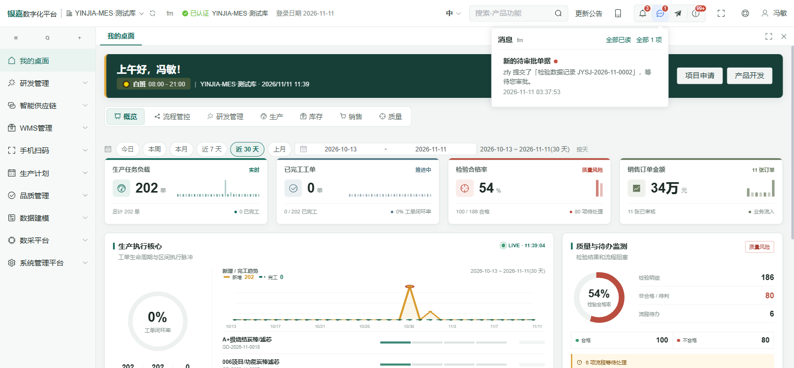
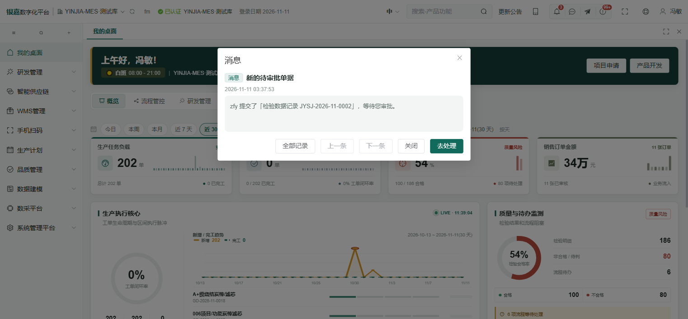
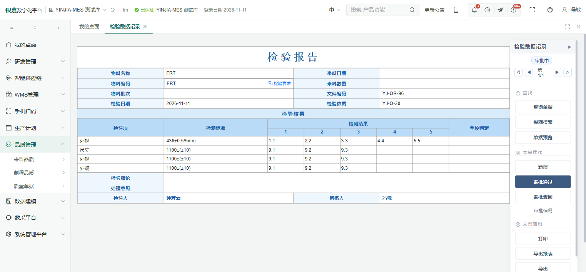
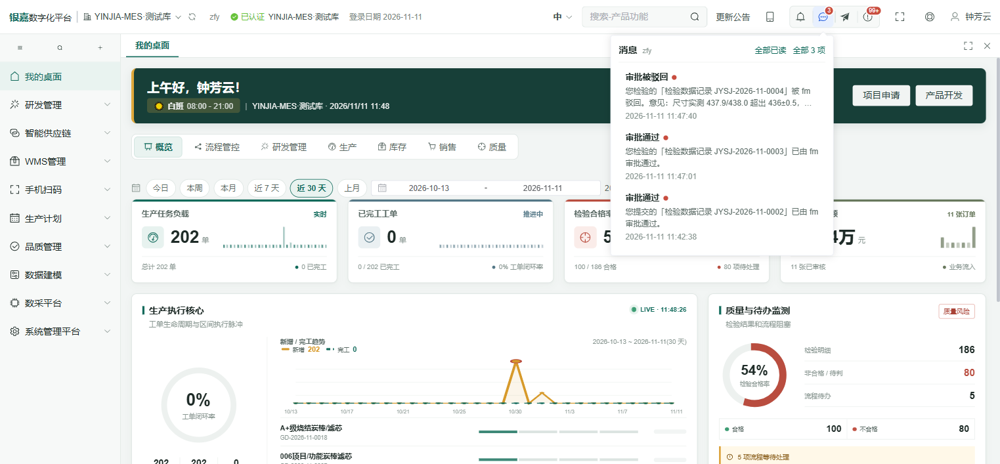
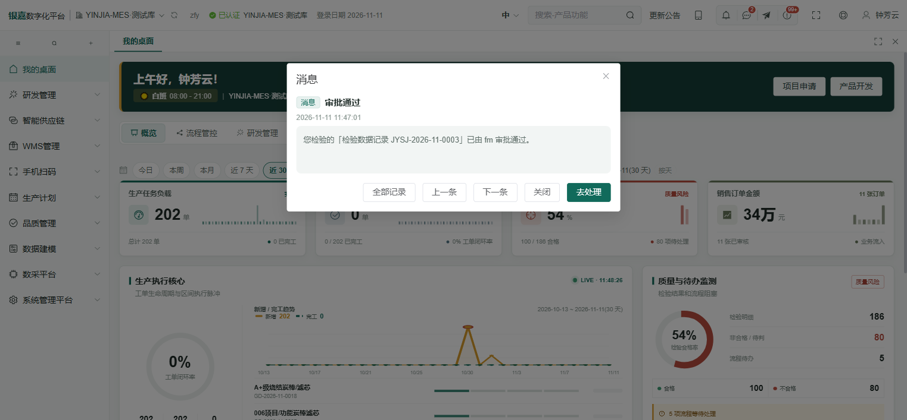
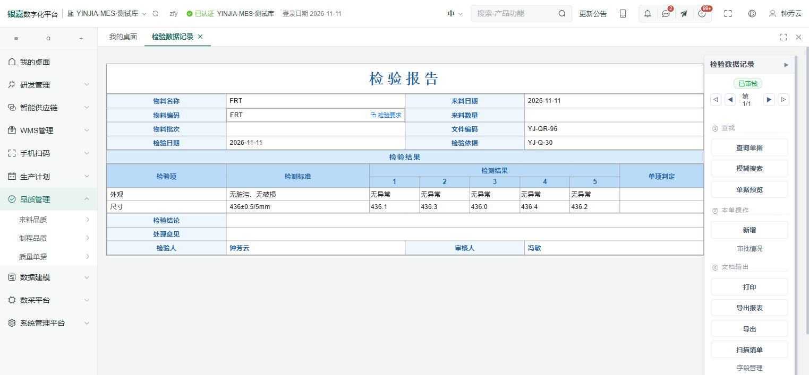
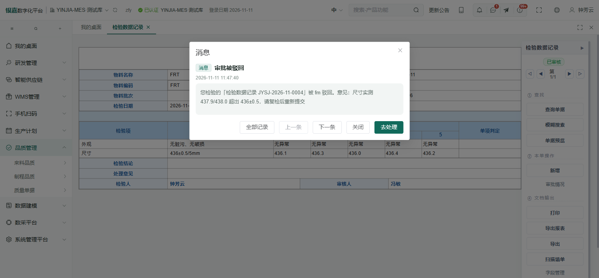
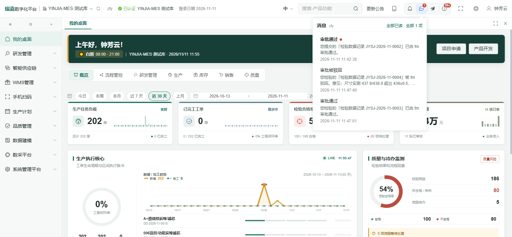
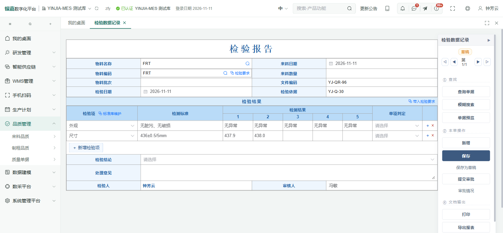

# 检验报告审批消息通知(组织结构配置 + 检验人回执 + 消息跳转)

> 2026-11-11 用户口径(逐条对照):
> 1. 「先根据 `D:\YINJIA-main\服务器数据库备份` 的组织结构进行配置。」
> 2. 「这个检验报告的消息提示,要在提交审批的时候通知审核人,也就是要提示冯敏这个账号待审批了。」
> 3. 「还要审批通过和驳回也要有消息提示对应的检验人。」
> 4. 「并且根据消息跳转要能够跳转到对应单据的页面,现在只能跳转到首页。」
> 5. 「这个实现后用 ego 去做点击测试,并且文档保留每个人收到消息的截图。」

## 一、组织结构:按服务器备份对齐(第 1 条)

### 1. 备份从哪来、怎么读

| 项 | 内容 |
|---|---|
| 备份文件 | `服务器数据库备份/HSDZ_MES_manual_20261111-110118.bak`(服务器 2026-11-11 11:01 打的完整备份,238 MB) |
| 只读还原 | 本机 SQL 实例还原成巡检库 **`HSDZ_MES_SRV`**(`RESTORE … WITH MOVE … REPLACE`,只读对照,不参与业务,跑完可整库丢弃) |
| 取证生成器 | `tools/archive/_org-sync-20261111/GenOrgSql.java`(读巡检库 → 生成迁移脚本,勿手改脚本) |
| 迁移脚本 | `tools/migrate-org-from-server-20261111.sql`(幂等,整表重灌) |

### 2. 本机原来差在哪(这条不配,通知永远发不出去)

通知的收件人是**服务端算出来的**:`MessageService.approversOf(panel)` = 管理员 ∪
「`yj_role_panel` 里该面板 `can_approve='Y'` 的角色」下的账号。而本机原来是:

| 项 | 本机(改前) | 服务器(改后) |
|---|---|---|
| `yj_dept` 部门 | 20 | 20 |
| `yj_role` 角色 | 4 | **20** |
| `yj_user` 账号 | 7 | **32** |
| `yj_role_panel` 面板权限行 | 691 | **1640** |
| `QC_INSP_REC` 有审批权的角色 | **0 个** | 5 个(生产 / 质量审核 / 总经理 / 品质审核 / 扫码报工领料) |
| 冯敏 | `fengmin` = **停用的普通用户**,无审批权 | `fm`(质量审核,可审批)+ `fengmin`(文件负责人) |

⇒ 改前点「提交审批」,`approversOf` 解析出来一个人都没有(管理员除外),**冯敏永远收不到**。

### 3. 脚本做了什么

- `yj_dept` / `yj_role` / `yj_user` / `yj_role_panel` **整表按服务器现状重灌**(带 `IDENTITY_INSERT`,id 与引用关系保持一致);
- 本机**独有**的四个面板(`LINE_CAP` / `QC_CUT_INSP` / `QC_FIN_SPEC` / `QC_MOLD_INSP`)的授权行**保留**,
  它们引用的老角色 id(3=文件负责人、4=研发审核)按 `role_code` 重映射到服务器 id(1025 / 1026);
- **口令不入仓库**:执行时先把本机 `admin` 的哈希取进临时表,重灌后所有账号统一用它
  ⇒ 本机所有人的密码 = admin 的密码(空库则回落到开发口令 `123456`);
- **手机端字段不照抄**(`MobId` / `phoneNo` 属个人数据):本机要用手机扫码登录,另行在账号上配;
- 只允许在 `HSDZ_MES` / `HSDZ_MES_TEST` 上执行(`IF DB_NAME() NOT IN (…) RAISERROR`),防止误在巡检库/服务器库上跑;
- 末尾自检:部门 ≥ 20、角色 ≥ 19、无空口令、`fengmin` 启用、`QC_INSP_REC` 至少一个 `can_approve='Y'`。

执行结果(两账套均「执行 0、失败 0」,重复执行为空操作):

```
部门 20 | 角色 20 | 账号 32 | 启用 32 | 面板权限行 1640 | 检验报告可审批角色 5
冯敏: fm / 质量审核 / 启用 ; fengmin / 文件负责人 / 启用
```

> 改前先各打了一份库备份:`D:\SQLData\HSDZ_MES-before-org-20261111.bak`、`HSDZ_MES_TEST-before-org-20261111.bak`。

## 二、消息链路:三条通知 + 能跳到单据(第 2/3/4 条)

| 场景 | 收件人 | 消息码 | 前端文案(PanelxNotice) |
|---|---|---|---|
| 提交审批 | 该面板**有审批权的账号 + 管理员**(实测 10 人,含冯敏 `fm`) | `APPROVAL_SUBMITTED` | 新的待审批单据：{actor} 提交了「{panelName} {docNo}」，等待您审批。 |
| 审批通过 | 制单人(`asp_user1`) | `APPROVAL_APPROVED` | 您提交的「…」已由 {actor} 审批通过。 |
| 审批通过 | **单据上的检验人/检验员** | `APPROVAL_APPROVED_INSPECTOR`(**新**) | 您检验的「…」已由 {actor} 审批通过。 |
| 审批驳回 | 制单人 | `APPROVAL_REJECTED` | 您提交的「…」被 {actor} 驳回。意见：… |
| 审批驳回 | **单据上的检验人/检验员** | `APPROVAL_REJECTED_INSPECTOR`(**新**) | 您检验的「…」被 {actor} 驳回。意见：… |

改动落点:

- `MessageService`
  - 新增两码 `APPROVAL_APPROVED_INSPECTOR` / `APPROVAL_REJECTED_INSPECTOR`;
  - 新增 `inspectorOf(headTable, docNo)` —— 按 `检验人 → 检验员 → 检测人 → 化验人` 找**该表实际存在**的列
    (检验报告是「检验人」,首件/制程/组装成品/出厂报告是「检验员」);
  - 新增 `accountsOf(who)` / `inspectorAccounts(...)` —— 这一格库里**两种写法都有**
    (历史单写账号 `admin`,新增按登录人 `real_name` 写 `钟芳云`) ⇒ 先按 username 精确匹配,再按姓名匹配;
  - 消息列表的时间列转 `LocalDateTime` 再出(修「库里 11:37、弹层显示 03:37」的 8 小时偏差)。
- `ButtonService`
  - 新增 `notifyApprovalResult(def, no, approved, params, actor)`:制单人 + 检验人两端各发一条,同人不重复;
  - 单级审批(检验报告走这条)与两级审批(质量单据一族:批准通过/二级驳回)**都**接上了检验人。
- `frontend/src/layout/NoticeCenter.vue`
  - 补两码的模板词条(否则渲染成通用「业务消息」);
  - 「去处理」跳转由 `?focus=<单号>` 改为 **`?docNo=<单号>`** —— 面板列表
    (`PanelxList.applyDocNoQuery`)只认 `docNo`,传 `focus` 等于没传,所以此前"只能回到首页"。
- `frontend/src/i18n/locales/en.js`:两条新模板的英文词条。

## 三、ego 实机点击验证(第 5 条)

环境:`http://localhost:5173`(vite,源码即时生效)+ 后端 `127.0.0.1:8090`(新 jar),登录工厂 **YJ_TEST**(测试库)。
密码统一为 `123456`(组织结构配置时所有账号取本机 admin 的哈希)。

脚本按 `C:/Users/Lenovo/ego/qc-insp-rec-result5-20261111/round-NN.mjs` 原样拷进
`tools/archive/_org-sync-20261111/`,可原样复跑(需 5173 + 8090 都在)。

### 1. 检验人 `zfy`(钟芳云 / 质量检测)提交审批

- 新建检验报告 `JYSJ-2026-11-0002`,填 5 格实测值 → 保存 → 提交审批;
- 落库:`pending='Y'`、`pending_by='zfy'`、`检验人='钟芳云'`;
- 消息:`APPROVAL_SUBMITTED` 落到 10 个审批人账号(含 `fm`)。

### 2. 审核人 `fm`(冯敏 / 质量审核)收到「新的待审批单据」





点「去处理」→ **跳到该单据页面**(`JYSJ-2026-11-0002`,状态「审批中」,右侧出现「审批通过 / 审批驳回」):



### 3. 冯敏审批通过 / 驳回后,检验人 `zfy` 收到两条回执

> 为了让「检验人 ≠ 制单人」这条新链路可验,`JYSJ-2026-11-0003 / 0004` 的
> `asp_user1`(制单人)是 `admin`,纸面「检验人」是 `钟芳云`;由 `zfy` 提交、`fm` 审批。
> 0003 通过、0004 驳回(意见:尺寸实测 437.9/438.0 超出 436±0.5,请复检后重新提交)。

`zfy` 的消息列表(两条「您检验的…」):



审批通过回执 → 点「去处理」跳到 `JYSJ-2026-11-0003`(状态「已审核」):





驳回回执(带驳回意见)→ 点「去处理」跳到 `JYSJ-2026-11-0004`(状态回到「草稿」,五格里就是被驳回的 437.9/438.0):




### 4. 落库证据(`yj_message`,测试库)

| 单据 | 收件人 | 消息码 | 说明 |
|---|---|---|---|
| JYSJ-2026-11-0002 | fm 等 10 人 | `APPROVAL_SUBMITTED` | 提交通知(冯敏在收件人里) |
| JYSJ-2026-11-0002 | zfy | `APPROVAL_APPROVED` | 该单制单人=检验人=zfy,只发一条(去重) |
| JYSJ-2026-11-0003 | admin / **zfy** | `APPROVAL_APPROVED` / **`APPROVAL_APPROVED_INSPECTOR`** | 制单人与检验人各一条 |
| JYSJ-2026-11-0004 | admin / **zfy** | `APPROVAL_REJECTED` / **`APPROVAL_REJECTED_INSPECTOR`** | 同上,驳回意见随消息带上 |

### 5. 8090(打包版)同样验证一遍

`npm run build` + 同步 `backend/src/main/resources/static` + 重打 jar 后,在
`http://127.0.0.1:8090`(登录工厂选 **YINJIA-MES·测试库**)复验:消息列表时间已本地化(11:47),
点驳回消息「去处理」同样落到 `JYSJ-2026-11-0004`。





### 6. 回归

- `node --test`(frontend):**1647/1647 通过**,含新增
  `frontend/src/layout/noticeCenterJump.test.js` 3 条(钉住 `docNo` 跳转 + 两码模板 + 英文词条);
- `DbSync` 两账套:`执行 0 / 跳过 744 / 失败 0`;
- 巡检库 `HSDZ_MES_SRV` 用完可整库删除(`DROP DATABASE HSDZ_MES_SRV`),它是**服务器备份的只读对照**。

## 四、审批权角色清单 + 「只通知 fm」(2026-11-11 第二轮口径)

### 1. 「检验人 = 点新增的那个人」——确实如此

纸面「检验人」这一格是 `docDefaults` 的 LOCKED_PERSON:在**点「新增」那一刻**按登录账号写入
(写的是 `real_name`),之后不随保存/编辑/审批变。实测正式库 68 张报告:

| 检验人 | asp_user1(制单人) | 行数 |
|---|---|---|
| admin / 系统管理员 | admin | 47 |
| (空) | admin | 21 |

⇒ 检验人 = 制单人 = 新增人,三者是同一个人。所以「审批通过/驳回通知检验人」与「通知制单人」在
正常单子上是**同一条消息**(代码里按人去重,不会重复打扰);新增的 `*_INSPECTOR` 两码只在
**检验单自动生单**(报告由 `QcCatalogService` 建出来、检验人格可能为空或另有其人)时才会多出一条。

### 2. `QC_INSP_REC` 上有审批权的角色(= 原来会收到"待审批"的人)

| 角色 id | 角色 | 账号 |
|---|---|---|
| 1033 | 生产 | WANGGUANGZHEN、TANCHENG |
| 1039 | 质量审核 | cmj、**fm（冯敏）** |
| 1042 | 总经理 | (无账号) |
| 1048 | 品质审核 | (无账号) |
| 1049 | 扫码报工领料 | qietan、chengxing、zuzhuang、hunliao |
| — | 管理员(恒收) | admin、zjl |

合计 **10 个账号** —— 这就是改前一提交就有 10 条消息的原因。

### 3. 只通知 fm:改一个面板配置,不动审批权

「谁收提醒」和「谁能审批」是两件事,所以做成了**面板级配置**(不是把别人的审批权削掉):

```json
// yj_panel.config(QC_INSP_REC)
{"approvalNotify":["fm"]}
```

- 配了它 ⇒ 该面板「提交审批」的消息**只发给这些人**(管理员也不再自动带);
- 不配 / 空数组 ⇒ 回到原口径(全部审批人 + 管理员);
- **审批权一点没动**:上面 5 个角色照样能点「审批通过/驳回」,只是不再收到提醒。

落地:`tools/migrate-qc-insp-rec-approval-notify-20261111.sql`(两账套已执行,幂等),
代码在 `MessageService.sendToApprovers → approvalNotifyTargets()`。

实测(测试库 `JYSJ-2026-11-0004` 重新提交):

```
改前 11:45:01  →  APPROVAL_SUBMITTED × 10(admin/zjl/WANGGUANGZHEN/TANCHENG/cmj/fm/qietan/chengxing/zuzhuang/hunliao)
改后 12:04:26  →  APPROVAL_SUBMITTED × 1 (仅 fm)
```

![fm 只收到一条]](../../tools/archive/_org-sync-20261111/round-44-submit-fm-only.png)

> 要换成别人 / 加人:`UPDATE yj_panel SET config = JSON_MODIFY(config,'$.approvalNotify',JSON_QUERY(N'["fm","cmj"]')) WHERE panel_code=N'QC_INSP_REC';`
> 要取消:`JSON_MODIFY(config,'$.approvalNotify',NULL)`(回到"全部审批人都收")。

## 五、需要知道的边界

1. **提交通知默认仍是"所有审批人 + 管理员"**,本批把 `QC_INSP_REC` 收口到 `fm`;其它面板(特采单、
   首件/制程检验单等)仍是全员口径 —— 要收口就照上面那样加一行 `approvalNotify`。
2. **如果 fm 自己提交**,提醒会因为"不发给自己"而落空(此时只有她能审,属预期)。
3. **检验人这一格可能是账号也可能是姓名**(历史单两种都有),代码两种都认;重名(如两个"冯敏"账号)
   会把消息发给所有同名账号。
4. **手机端字段(MobId/phoneNo)没有从服务器备份带过来**,本机手机扫码登录要用的话另行配置。
5. 服务器备份巡检库 `HSDZ_MES_SRV` 占约 240 MB(`D:\SQLData`),确认不再需要后可直接删库。
