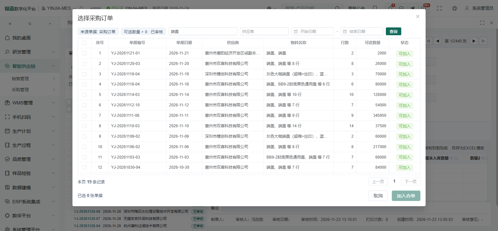
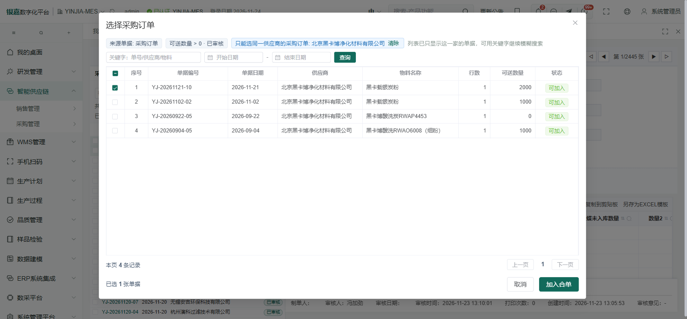

# 合单选单 · 勾一张就只剩同一供应商 + 关键字模糊搜索(2026-11-24 第三轮)

用户口径(原文):

> 「合单生单选择时，勾选后一个后只出现同一供应商，并且支持模糊搜索」

## 改了什么

| 位置 | 内容 |
|---|---|
| `MergePickDocsDialog.vue` | ① 勾到第一张 → 供应商锁成这一家并**重新查询**(服务端 `供应商` 条件),列表里不再出现别家;`keepPicked` 按单号回填刚勾的那张,`syncing` 挡住回填期间的副作用;全部取消勾选 → 自动解锁 + 恢复全量候选。② 顶部关键字改为**模糊搜索**,透传 `keyword` 给服务端 broad-OR;新增「物料名称」列(前两个物料名 + 等 N 行),模糊搜物料时一眼看出命中在哪张单。 |
| `engine.js` | `outsourceFlowSources` / `purchaseFlowSources` 增 `keyword` 透传 |
| `VoucherFlowService.java` | `sources(...)` 增 keyword 重载 → `queryFormDataList(sourcePanel, keyword, cond, ...)`(原来写死 `null`,只能按单号查) |
| `PxController.java` | `/px/voucherFlow/sources` 读 `body.keyword` 交给服务 |
| `mergeGenerate.test.js` / `en.js` | ② 新增断言:勾第一张就 `load(1,{keepPicked:true})`、keyword 端到端透传;补两条英文词条 |

## 实测(Ego lite,5173 源码版 + 8090 后端已换新 jar,正式账套,只读未生成单据)

### 模糊搜索(关键字命中三类字段)

| 关键字 | 结果 | 命中列 |
|---|---|---|
| 空 | 19 条(多家供应商混排) | — |
| `双喜` | 19 条,供应商全是「惠州市双喜科技有限公司」 | 供应商(单号里没有这两个字) |
| `20261114` | 4 条,单号都含 20261114 | 单据编号 |
| `端盖` | 19 条,物料列全部含「端盖」(含「灰色大咖端盖(超棉+丝印)」) | 物料名称(明细行) |

### 勾一张就只剩同一供应商

| 步骤 | 结果 |
|---|---|
| 清空关键字后首行 = `YJ-20261121-10` / 北京黑卡博净化材料有限公司 | 勾它 |
| 重查后列表 | **4 条,供应商全部 = 北京黑卡博净化材料有限公司** |
| 刚勾的那张 | 仍勾着(`已选 1 张单据`) |
| 顶部提示 | 「只能选同一供应商的采购订单: 北京黑卡博净化材料有限公司(清除)」+「列表已只显示这一家的单据，可用关键字继续模糊搜索」 |




## 环境说明(本轮动了后端)

模糊搜索要后端支持 ⇒ 按仓库工具链从**干净 HEAD 树**重建 `yinjia-mes-backend-0.1.0.jar`
(`mvn -s tools/settings.xml -DskipTests package`,JDK25),备份旧 jar 为
`backend/target/yinjia-mes-backend-0.1.0.jar.bak-2038`,再用 `tools/scripts/start-prod.ps1` 重启 8090。
⚠ 该脚本顺带跑的 DB 增量同步在 `migrate-qc-proc-insp-batch-table-20261111.sql` 中止(741 跳过/1 失败),
**与本次改动无关**(本轮没有改任何 SQL),服务照常起来了。

## 复跑

```powershell
ego-browser nodejs -e "await import('file:///<本目录>/round-14.mjs')"   # 模糊搜索三连
ego-browser nodejs -e "await import('file:///<本目录>/round-13.mjs')"   # 勾一张只剩同一家
```
