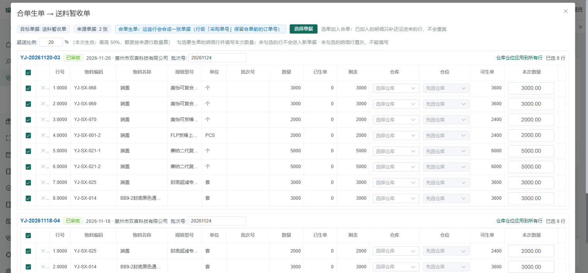
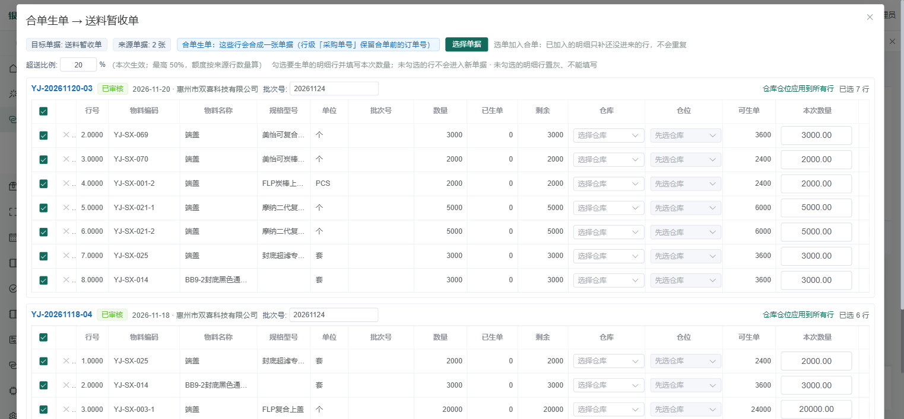

# 合单生单 · 删除改成「明细行首一个叉」(2026-11-24 第二轮)

用户口径(原文):

> 「能不能删除单一明显的」 → 追问后明确:「直接在明细中加入一个叉点击后删除」

## 改了什么

| 位置 | 内容 |
|---|---|
| `GenerateLinesDialog.vue` | 明细表在**勾选列右边第一格**新增一列「叉」:每行一个 `✕`,点一下就把这一行从本次合单里移除(悬停变红底白叉)。**删除只剩这一个入口** —— 原「删除本单」(单据行头)与「操作」列(最右的「删除行」)一并撤掉;某张单的行删空时该单自动撤掉 |
| `mergeGenerate.test.js` | ⑤ 改成钉「行首的叉」:叉必须在「行号」列之前、有 `tt('删除这一行')` 的 title、不再出现「删除本单/删除行/操作」 |
| `en.js` | 新增 `删除这一行` 词条 |

为什么放行首而不是行尾:合单表 96vw 宽(仓库/仓位/本次数量/状态等 16 列),原来的「删除行」在最右一列,
必须横向滚到底才看得见 —— 这正是"不明显"的根因;行首第一格任何位置都在视野内。

## 实测(Ego lite,5173 源码版,正式账套,只读)

| 检查 | 结果 |
|---|---|
| 每行都有叉 | 第一张单 8 行 = 8 个 `.gl-x`,第二张 6 行 = 6 个 ✅ |
| 叉的位置 | 第一行单元格顺序:`[勾选] [✕] [行号 2.0000] [YJ-SX-069] …`(行号之前) ✅ |
| 点叉删一行 | 已选 14 行 / 合计 106000 → 13 行 / 103000 ✅ |
| 删除本单已撤 | 单据行头只剩「仓库仓位应用到所有行」+「已选 N 行」,`hasDelDoc=false` ✅ |
| 操作列已撤 | 表头以「状态」结尾,无「操作」 ✅ |

复跑:`ego-browser nodejs -e "await import('file:///<本目录>/round-11.mjs')"`
