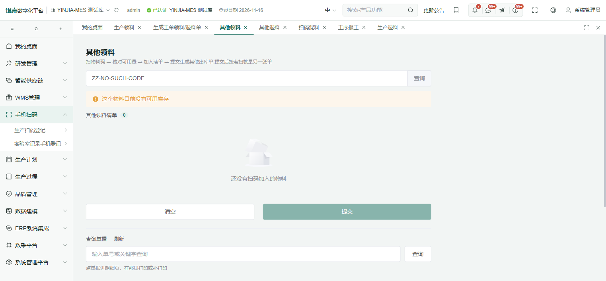

# 手机扫码 PDA 连扫光标(2026-11-16)

**用户口径(原话)**
> 「手机扫码的所有的扫码都需要做到刚进入和扫码结束后光标在二维码查询的那一栏，方便 pda 多次扫码使用」
> 「如果是领料的话，就是填完数量确定后再次回到二维码光标」

## 一、为什么必须做

PDA 的扫码枪是**当键盘**往"当前焦点"里逐字输入 + 回车。焦点只要跑到数量框、按钮或页面空白上,
下一次扣扳机就是**打空** —— 现场表现是"扫了没反应",人得腾出手指点一下输入框,连扫就断了。

## 二、做法

新增 [business/scanFocus.js](../../../frontend/src/business/scanFocus.js):

- `focusScanNow(target, { delay })`:把焦点(并 `select()` 选中旧值)放到扫码框;
  `target` 可以是 ref / DOM / ElInput 实例 × getter(目标会变:先扫工单 → 焦点该去物料框);
- 用 `nextTick` + 可选 `delay`(等 ElMessage / 列表重渲染,免得刚聚焦就被抢走);
- **必须 `select()`**:否则扫码枪的字会接在旧值后面(`0@A` + `0@B` = 鬼码)。

每个扫码页在三个时机调它:①进页面(mounted / keep-alive 的 activated);②每次扫码处理完(finally,含失败/没命中);③各页的"确定/添加/提交"之后。

| 页面 | 扫码框 | 落焦时机 |
|---|---|---|
| 生产领料(定位)· `MobilePickList` | `扫工单号/领料单号…` | 进入 / 定位完(含失败) |
| 生成工单领料退料单 · `MobilePickCreate` | `扫工单码或输入工单号` | 已有 mounted / addQueue;补**批量生成完** |
| 其他领料 / 其他退料 · `MobileOtherScan` | `扫描或输入物料码` | 已有 mounted / addLine / reset;补**扫完(onScan)** |
| 扫码混料 · `MobileMixScan` | 工单码 + 物料码 | 已有 mounted / 选行 / 提交本笔;补**扫工单的 finally**、**扫物料的 finally(含没命中)**、**提交失败的 finally** |
| 工序报工 · `MobileReport` | `扫工单码或输入工单号` | 已有 mounted;补**查询工单完**、**提交报工完** |
| 生产领料单(单据里扫码)· `MobilePickDoc` | `扫物料码或输入物料编码` | 已有 mounted / 写入 / 取消;补**扫物料的 finally** |
| 生产退料 · `MobileReturnList` | `扫物料码或输入物料编码` | 新增 ref + **进入 / 选中单据 / 扫完 / 加入 / 提交完** |

领料「填完数量确定后回到光标」对应三处:`MobilePick.addLines`(**添加**)、`MobilePickDoc.saveQty`(**写入**)、
`MobileReturnList.addLine`(**加入**)—— 这三处原本已有/本次补上,都会自动回到物料扫码框。

> `MobilePick.vue`(老的整页版)已不在路由里(路由用的是 `MobilePickList` / `MobilePickDoc`),但代码仍在,
> 一并按同一口径处理,免得日后被重新挂上时又丢焦点。

## 三、验证(ego 浏览器,测试库)

`round-07.mjs`:逐个路由**不点任何输入框**,直接看 `document.activeElement`,再往焦点里打字 + 回车,再看一次:

| 页面 | 进入时焦点 | 回车(扫描)后焦点 |
|---|---|---|
| 生产领料(定位) | `扫工单号/领料单号,或直接输入后点打开` | 同左 ✅ |
| 生成工单领料退料单 | `扫工单码或输入工单号` | 同左 ✅ |
| 其他领料 | `扫描或输入物料码（存货编码\|批号）` | 同左 ✅ |
| 其他退料 | `扫描或输入物料码（存货编码\|批号）` | 同左 ✅ |
| 扫码混料 | `扫描或输入工单二维码` | 同左 ✅ |
| 工序报工 | `扫工单码或输入工单号` | 同左 ✅ |
| 生产退料 | `body`(该页扫码框 `v-if="cur"`,**没选单时本来就没有框**) | — |

`round-08.mjs`:生产退料页在测试库里**没有可退单据**(可退单据=已完成且材料出库单已审核),
所以"选中单据后落焦"这条无法在该库实测 —— 代码与其它页同一套(选中即 `focusScanNow`),
现场选一张单即可确认。

